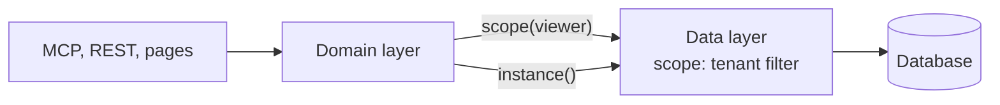

# One data layer, the tenant in one place

**Layers are strict: the surfaces call the domain layer, and only the data layer talks to the database. When an app holds data for more than one tenant (a household, a book, a workspace, a team), the tenant is applied in that one layer, by a scope built from the session, never by each query.** Decided 2026-10-31.

## Why

A filter that every query has to remember will one day be forgotten, and in an app hosted for several tenants that is a leak from one customer to another. One mechanism can be read, tested and checked by a machine; a tenant filter copied into a hundred queries can't. The same goes for the layering: once domain code can reach the database client, nothing stops a query that goes around the scope, and review is the only guard left.

freundebuch decided it when one household per instance became several books per instance, as a step towards a hosted service (ADR 0025).

## How

The domain layer asks the data layer for a scope; only the data layer holds the database client.

- **The data layer owns the database client and the migrations.** Everything else gets a narrower handle from it. The domain layer never imports the query builder (only its types) or the connection.
- **A scope comes from the session.** `scope(viewer)` returns a handle whose reads, updates and deletes on tenant tables are narrowed to the viewer's tenants, and whose inserts are stamped with the tenant. Domain functions take the viewer, never a tenant id passed by hand.
- **Tables are either tenant tables or instance tables**, listed in the data layer. Tenant tables carry the tenant id. References between them include it (a composite key `(tenant_id, x_id) → x(tenant_id, id)`), so the schema itself refuses a row that points into another tenant. Instance tables (users, their settings, the tenants and their members) go through a separate handle.
- **Jobs without a user run tenant by tenant**, each in a system scope for that tenant, never on a handle that sees everything.
- **Lint enforces the layering**: `no-restricted-imports` keeps the database client, the connection and the migrations inside the data layer.
- **Tests enforce the tenant**: in tests the query builder gets a plugin that fails any query on a tenant table that doesn't compare the tenant id, raw SQL included. A schema test fails a table that is neither listed as an instance table nor carries the tenant id. A privacy test seeds two tenants and checks every read path keeps them apart.
- **Item privacy inside a tenant** stays [one gate for every read](one-gate-for-every-read.md); the scope is the outer wall, the gate the inner one.

## Rules out

- Importing the database client, the connection or the query builder (other than its types) outside the data layer.
- A tenant id passed by hand into domain functions, or read from a request parameter instead of the session.
- Raw SQL that reads a tenant table outside the data layer, or inside it without comparing the tenant id.
- A plugin that silently adds the tenant filter to every query as the only guard: it rewrites queries out of sight, and subqueries, CTEs and inserts become edge cases. As a check in tests it is fine.
- A job that reads every tenant through one unscoped handle.

## Reference

freundebuch: `backend/db/scope.ts`, `backend/db/check.ts`, `eslint.config.mjs`, ADR 0025 (books in one scoped database), [freundebuch#114](https://github.com/Marceltov/freundebuch/pull/114).
