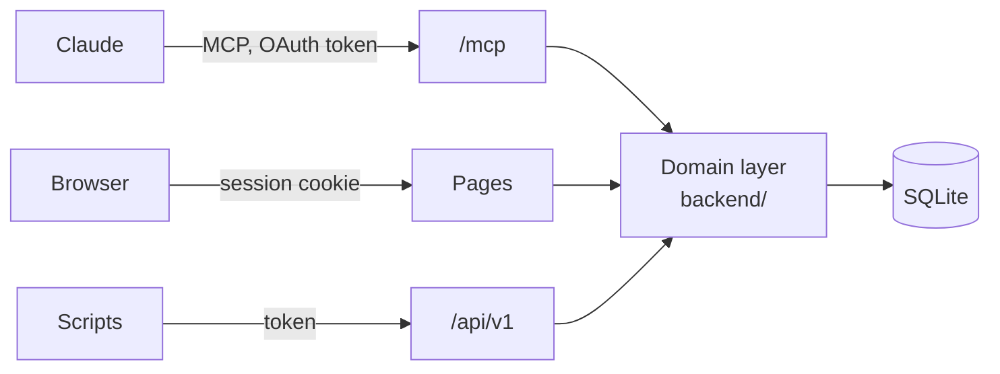

# MCP first, one domain layer

**An app is built for Claude first: every feature works over MCP before the REST API and the web pages follow. All three surfaces call the same framework-free domain layer, and every tool result tells Claude what to do next.**

## Why

The apps are AI-first: the user talks, Claude files and reads back. A feature that only the web app has can't be used the way the app is meant to be used, and three surfaces with their own logic drift apart. Guidance that lives only in tool descriptions costs context in every session, and Claude has to apply it before it knows what a call will do (freundebuch ADR 0010).

## How

Every surface is a thin adapter over one domain layer.

- **`backend/` is framework-free** and the frontend imports it only through `backend/index.ts`. ESLint enforces the boundary with `no-restricted-imports`: no `next` or `react` inside `backend/`, no deep imports into it from `app/` or `components/`.
- **A feature lands over MCP first**: the tool, its description and what it returns. REST and the pages follow in the same or a later change.
- **Every tool result carries `next: string[]`**: short English instructions built from what this call did (the default day it chose, the relationship that already existed, what a merge moved). It is written only in the tool layer, so REST stays plain data. What Claude needs _before_ a call stays in the descriptions; what only matters _after_ moves into `next`.
- **Tokens are bound to one surface**: an MCP token fails on REST and the other way round, and the browser cookie never works on MCP.
- **Every result that names an item carries its URL in the web app**, so Claude can hand the user a link.
- **The REST API has a route table** from which `openapi.json` is generated and committed; CI fails when it differs.

## Rules out

- A feature only the web app or only REST has; an MCP tool that lags behind the API.
- Domain logic in route handlers, React components or the tool layer.
- `backend/` importing Next.js, React or the frontend.
- After-call guidance only in tool descriptions or server instructions, where a client may drop it.
- One token that works on every surface.

## Reference

freundebuch: `backend/`, `backend/tools.ts`, `eslint.config.mjs`, ADR 0001 (AI-first app with a built-in MCP) and ADR 0010 (tool results tell Claude what to do next). questlog follows it (ADR 0001).
