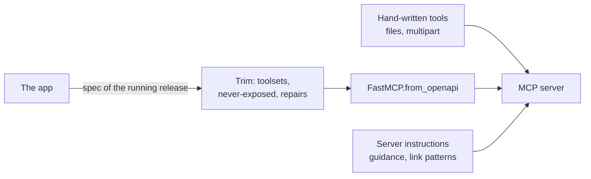

# MCP server for another app's API

**An MCP server in front of another app's API generates its tools from that app's OpenAPI spec with `FastMCP.from_openapi`, trims them with toolsets and a never-exposed list, and gives Claude its guidance once, in the server instructions. Tools are written by hand only where the app has no spec, or for the few operations a generated tool can't do.** Decided 2026-11-28.

## Why

[MCP first](mcp-first.md) is about apps that build their own MCP surface: there the tool layer is ours, and every result can carry `guidance` and a link. A server in front of someone else's API is another kind of project. Its job is to make that API usable for Claude, and the API is defined by the spec of the release that runs, not by us.

karakeep-mcp 0.1 and 0.2 applied MCP first anyway and hand-wrote 30 tools to put `guidance` and a `url` into every result. Within a day Claude found what the hand-written tools had left out and the spec had (smart lists, a list's `public` flag, the fields an update takes), and every Karakeep release would have widened the gap. Its sibling servers, paperless-ngx-mcp, invoiceninja-mcp and teamscale-mcp, all generated their tools from the spec. karakeep-mcp 0.3.0 was rebuilt from paperless-ngx-mcp's repository (2026-11-28).

## How

- **The spec of the release that runs.** Download it from the app at startup where the app serves one (paperless-ngx-mcp). Where it doesn't, ask the app for its version and take the spec at that release tag (invoiceninja-mcp ADR 0001, karakeep-mcp). Either way, bundle a snapshot as the fallback and log which source was used; a pinned spec (`<APP>_API_SPEC`) has no fallback.
- **Toolsets** by the first path segment, a curated default set and `all`; `MCP_TOOLSETS=default,<more>` adds to the defaults. Every tool costs context in every session.
- **A never-exposed list**: administration, credential and account-login operations, and anything a model can't use (a backup ZIP), dropped in every configuration.
- **Repairs before generation**, each with a test: `PUT` dropped where `PATCH` exists, a union body flattened so FastMCP keeps its fields, output schemas cleared where the app answers with bare arrays or empty bodies, `validate_output=False`.
- **Hand-written tools of the same name** only for what a generated tool can't do: an endpoint that returns a file (return FastMCP `Image`/`File`) and a multipart upload.
- **Guidance once, in the server instructions and a few tool guides**: how to search instead of paging, how to build a link into the web app, to ask before deleting. Refusals become errors that say what to do (a missing scope, sign in again).
- **One module, the sibling's layout**: `app/server.py`, unit tests against a fake app, a dev stack with a real, seeded instance, `run-tests.sh`, live tests pinned to that stack, and a coverage test that fails when a default tool has no live test.
- **Sign-in** through [mcp-login-oauth](../stacks/mcp-login-oauth.md), with the app's own token in the header as the alternative.

Without a spec, hand-written tools are the way, and they follow MCP first's result shape (mailflow-mcp ADR 0001).

## Rules out

- Hand-written tools over an API that has an OpenAPI spec, for the sake of per-result `guidance` or links.
- Tools frozen to the spec of one version when the running release's spec can be had.
- A never-exposed operation (administration, credentials) reachable through any `MCP_TOOLSETS` value.
- A new server that doesn't start from its siblings' repository layout.

## Reference

paperless-ngx-mcp (`app/server.py`, ADRs 0002 and 0003), invoiceninja-mcp (ADR 0001, the spec at the instance's version), teamscale-mcp, karakeep-mcp 0.3.0 (ADR 0002, Marceltov/karakeep-mcp#8). Without a spec: mailflow-mcp ADR 0001.
