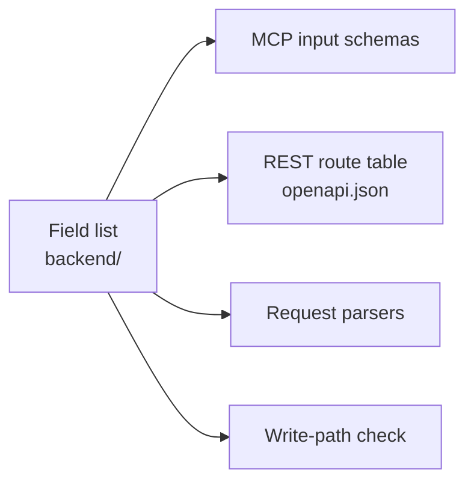

# One field list for every surface

**A domain object's fields are listed once, in the domain layer: each field's name, limit, rule and description. Every surface that takes them (the MCP tools, the REST API and its `openapi.json`, request parsers, the write-path check) is built from that list instead of writing the fields out again, and a test fails when a surface leaves one out.** Decided 2026-11-14.

## Why

When each surface lists the fields itself, the copies drift: a limit changes in one place, a description in another, and a new field reaches some surfaces but not others. In notefeed a note's title, sender, tags, date and draft were written out in the REST headers, the PATCH JSON, three MCP tools and two checks. The MCP tool `post_file` silently lacked `tags` and `date`, which REST had; nothing failed, because nothing compared the copies (notefeed/notefeed#384, 2026-11-14).

## How

- **One table per object** in the domain layer, next to its logic ([MCP first, one domain layer](mcp-first.md)): for each field its wire name (a header or JSON key), its kind, its limit, its rule, and what leaving it out or emptying it means when creating and when editing.
- **Builders, not copies**: small functions turn the table into what each surface needs, such as zod schemas for MCP tools and JSON bodies, header schemas for the route table, and a parser that reads a request into one typed object. A surface picks the fields it takes by name; the description and limit come along.
- **One check**: every write path (create, edit, every surface) validates through one function built on the same table.
- **A test per surface** asserts that it takes every field it should, so a field added to the table fails until each surface has it.
- **Client packages** build their requests in one helper each, not in every method. A published client can't import the server's table; its generated types from `openapi.json` keep it in step.
- A field a surface deliberately leaves out is left out by name in that surface, with the reason beside it.

## Rules out

- A field's limit, rule or description written out again per surface.
- A field added to REST but not to MCP, or the other way round.
- A write path with its own validation of fields the table already checks.

## Reference

notefeed: `backend/notefields.ts` and `backend/notefields.test.ts` (notefeed/notefeed#384).
