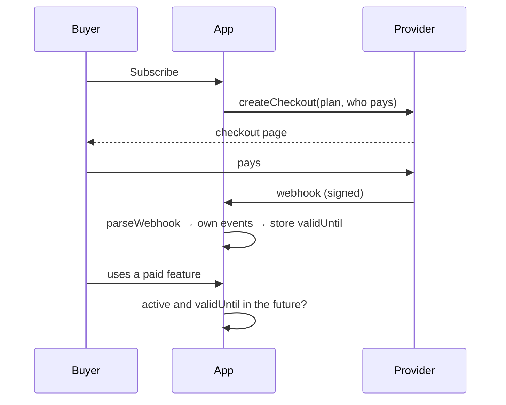

# Selling a hosted instance

**An app that sells its hosted instance takes payments only when a payment provider is configured; without one, every feature is on and no limit applies. The provider sits behind a small interface with a fake provider beside it, its webhook becomes the app's own events, access is checked locally against the end of the paid period, and prices live only in the provider.** Decided 2026-11-02.

## Why

notefeed began selling licenses on notefeed.me in October 2026, through Creem as merchant of record (notefeed ADR 0029). Gamepanion is next, with a subscription where notefeed sells one license per feed, so the same questions came up a second time. notefeed had already settled them, some by running into them:

- A refunded subscription kept running at Creem until the app cancelled it there too (seen in the sandbox).
- Prices kept in environment variables drifted from the products in the provider and had to be kept equal by hand (notefeed ADR 0035).
- A webhook can arrive twice, late or never, so access that only a webhook ends stays open for as long as the webhook doesn't come.
- Self-hosted instances must never lose a feature to a missing license (notefeed V6, Gamepanion V7).

## How

The provider talks to the buyer and to the app's webhook; the app decides access from its own store alone.

- **Off unless configured.** One setting, `<APP>_PAYMENT_PROVIDER`, names the provider: empty means no payments, no free tier and no limits, as on any self-hosted instance. Startup refuses an unknown provider, and a known one with a missing setting, and names the setting. Nothing calls the provider while it is empty.
- **One small interface,** everything provider-specific behind it, one module of the app its only caller: `plans()`, `createCheckout()`, `parseWebhook()`, `cancel()` and where buyers manage their purchases (`accountUrl`, or the portal of the signed-in user). The domain code never names the provider.
- **A fake provider beside the real one** (`<APP>_PAYMENT_PROVIDER=fake`): it charges nobody, signs its webhooks with HMAC under a secret from the settings, and drives the tests and development instances through the same paths as the real one.
- **The webhook becomes the app's own events.** Verify the signature over the raw body with a timing-safe comparison before parsing it. Translate the provider's event kinds into a few of the app's own (`started`, `renewed`, `cancelled`, `ended`, `refunded`) and ignore the rest. Applying an event twice changes nothing. A cancel keeps access to the end of the period already paid: a provider may report it at once (Creem sends `subscription.canceled` when the buyer cancels in the portal, with the period still running), so a cancel only stops the renewal. A period that ends unpaid, or an expired subscription, ends access. A refund or a dispute ends access at once and cancels the subscription at the provider as well.
- **Access is decided locally.** Each paid thing (a license, a user's subscription) is a row with `status`, `providerRef` (how a webhook finds it) and `validUntil`. A check reads the row and treats a passed `validUntil` as ended, whether or not the webhook for it came. The rows live in a SQLite file of their own (see [SQLite](../stacks/sqlite.md)), so restoring the content from a backup can neither revive nor drop a payment. The check is one function, like [one gate for every read](one-gate-for-every-read.md).
- **Prices live in the provider.** `plans()` reads the configured products (name, price, currency, tax mode), keeps them a few minutes, and answers the last list at once while it reads again or while the provider is down. Discounts (yearly against monthly) are computed from the two amounts. No price is written in a setting or in the code; the operator's terms are the only other place a price appears.
- **Ending never deletes.** When access ends, what was stored stays readable and exportable; only new paid things are refused. Exporting and deleting an account never need a payment.
- **Who pays travels through the checkout.** An app with accounts passes the user's id to the checkout and gets it back in the webhook. An app without accounts uses the provider's license key, which the buyer also finds in the provider's receipt (notefeed ADR 0036); a key never opens the provider's customer portal, since that shows every purchase of the buyer (notefeed ADR 0050).
- **The operator's side is documented privately.** Which products, webhooks and settings the hosted instance uses goes into the deployment's docs, not the app's public docs (see [operator pages](../repo-setup/operator-pages.md)).

## Rules out

- A license check, a free-tier limit or a call to the provider on an instance without a configured provider.
- The provider's name, its event kinds or its response fields outside the provider module.
- Acting on a webhook before its signature is checked, or an event that does harm when applied twice.
- Access that only a webhook can end: a check that ignores `validUntil`.
- A cancel that ends access before the end of the paid period.
- A refund that ends access in the app but leaves the subscription charging at the provider.
- Prices or discounts in settings, in the code or in UI copy.
- Deleting or hiding stored data when a payment ends; a payment needed to export or delete an account.
- Billing rows in the same database as the content.

## Reference

notefeed: `backend/payments/` (`types.ts`, `creem.ts`, `fake.ts`), `backend/licensing.ts`, `backend/licenseflow.ts`, ADRs 0029, 0035, 0036 and 0050. Gamepanion follows it for its subscription (gamepanion/gamepanion#48, `backend/payments/`, `backend/billing/`). Next, both replace their hand-written Creem module with Creem's official packages and keep only the mapping to their own records (see the roadmap); not a payments library of their own.
