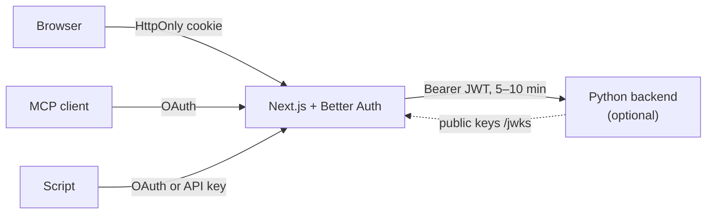

# Sign-in

**An app with a web UI and its own users signs in with Better Auth. An MCP server whose login is a form checked by the service behind it signs in with mcp-login-oauth. A backend never signs anyone in: it checks the token it is given.**

## Why

Sign-in is security code, and less of our own is better. Better Auth already does accounts, sessions, magic links, email codes, passkeys, any OpenID Connect provider and an OAuth server for MCP clients. mcp-login-oauth exists for the case Better Auth can't cover: an MCP server in front of another service (Trilium, Paperless, InvoiceNinja), where the login is that service's own and the grant carries its credentials. Decided 2026-10-30 in mcp-login-oauth ADR 0004.

## How

The sign-in lives in the Next.js app; anything behind it only checks tokens.

- **Web UI: backend-for-frontend.** The browser holds only Better Auth's `HttpOnly` session cookie and talks only to Next.js. When a separate backend exists, a Next.js route forwards the request with a short-lived JWT for the signed-in user. No token reaches the browser and there is no CORS.
- **MCP clients** sign in through OAuth at the app (`@better-auth/mcp`), with tokens bound to the MCP resource (RFC 8707).
- **Scripts** sign in like MCP clients, once through OAuth in a browser, with tokens bound to the API. A headless script uses an API key (stored hashed, can expire and be revoked), added when the first such script exists.
- **A backend** (Python or anything else) checks each JWT against the app's public keys: signature, issuer, audience, expiry. It takes the user id from the token and refuses any request without one, also from inside the network. Each kind of client gets its own audience. Access tokens live 5 to 10 minutes because a JWT can't be revoked before it expires.
- **During an MCP or script sign-in, an email holds only a code**, never a link: a link would let someone who started a sign-in with your address finish it when you click the genuine mail.
- **A person is their verified email by default**: a second sign-in joins an account only when the provider says `email_verified: true` and is trusted for it.
- **Sign-in data lives in its own SQLite file** next to the app's database, so backups and exports of the user's data hold no sessions or tokens.

Settings for Better Auth are on [Better Auth](../stacks/better-auth.md); the library for form-login servers on [mcp-login-oauth](../stacks/mcp-login-oauth.md).

## Rules out

- Hand-written OAuth, session or magic-link code in an app.
- A backend that runs its own sign-in or trusts a forwarded user id without a token.
- Tokens in the browser's JavaScript, in `localStorage` or in a URL.
- A magic link during an MCP or script sign-in.
- Joining two sign-ins on an unverified email.
- A long-lived access token for a backend.

## Reference

mcp-login-oauth ADR 0004 (apps with a web UI sign in with Better Auth); questlog ADR 0004 (sign-in with Better Auth, in its own SQLite file).
