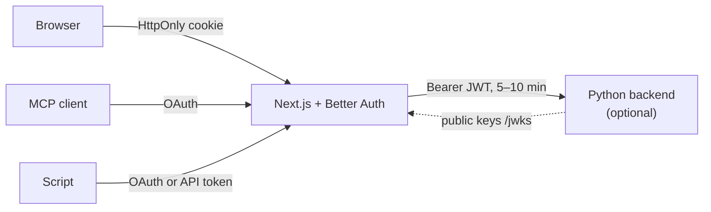

# Sign-in

**An app with a web UI and its own users signs in with [Better Auth](../stacks/better-auth.md). An MCP server whose login is a form checked by the service behind it signs in with [mcp-login-oauth](../stacks/mcp-login-oauth.md). A backend never signs anyone in: it checks the token it is given.**

## Why

Sign-in is security code, and less of our own is better. Better Auth already does accounts, sessions, magic links, email codes, passkeys, any OpenID Connect provider and an OAuth server for MCP clients. mcp-login-oauth exists for the case Better Auth can't cover: an MCP server in front of another service (Trilium, Paperless, InvoiceNinja), where the login is that service's own and the grant carries its credentials. Decided 2026-10-30 (questlog ADR 0004). On 2026-11-10 (noticebox ADR 0002) API tokens moved from "when the first script needs one" to "from the start", and an allowlist became the rule for who may sign in, because a provider like GitHub or Google lets anyone on the internet finish a sign-in.

## How

The sign-in lives in the Next.js app; anything behind it only checks tokens.

- **Web UI: backend-for-frontend.** The browser holds only Better Auth's `HttpOnly` session cookie and talks only to Next.js. When a separate backend exists, a Next.js route forwards the request with a short-lived JWT for the signed-in user. No token reaches the browser and there is no CORS.
- **MCP clients** sign in through OAuth at the app (`@better-auth/mcp`), with tokens bound to the MCP resource (RFC 8707).
- **Several providers, configured by env vars:** each OpenID Connect or built-in provider the app's env names becomes a button on the sign-in page (names on [Better Auth](../stacks/better-auth.md)).
- **Who may sign in is an allowlist:** `<APP>_ALLOWED_EMAILS`, addresses and `@domain` entries. Only a verified email on the list gets in; an empty list lets nobody in. The provider doesn't decide this.
- **Scripts** sign in like MCP clients, once through OAuth in a browser, with tokens bound to the API, or use an **API token**, from the start:
    - it belongs to a person and acts as that person; it has a name, a scope (`read` or `read+write`) and an expiry (90 days by default, at most a year, or none when chosen explicitly);
    - it is stored hashed and shown once; the list shows its last use, and it can be revoked;
    - it works on the REST API only, never on MCP or as a browser session;
    - it is created, listed and revoked in the app's settings and over MCP ([MCP first](mcp-first.md)).
- **Tests and local development need no provider.** End-to-end tests create a user and a session through Better Auth before they run and hand the cookie to the browser; unit tests call the domain layer with a user id. A dev-user env var may sign a developer in without a provider, and the app refuses to start with it in production.
- **A backend** (Python or anything else) checks each JWT against the app's public keys: signature, issuer, audience, expiry. It takes the user id from the token and refuses any request without one, also from inside the network. Each kind of client gets its own audience. Access tokens live 5 to 10 minutes because a JWT can't be revoked before it expires.
- **During an MCP or script sign-in, an email holds only a code**, never a link: a link would let someone who started a sign-in with your address finish it when you click the genuine mail.
- **A person is their verified email by default**: a second sign-in joins an account only when the provider says `email_verified: true` and is trusted for it.
- **Sign-in data lives in its own SQLite file** next to the app's database, so backups and exports of the user's data hold no sessions or tokens.

Settings for Better Auth are on [Better Auth](../stacks/better-auth.md); the library for form-login servers on [mcp-login-oauth](../stacks/mcp-login-oauth.md).

## Rules out

- Hand-written OAuth, session or magic-link code in an app.
- A backend that runs its own sign-in or trusts a forwarded user id without a token.
- Tokens in the browser's JavaScript, in `localStorage` or in a URL.
- A magic link during an MCP or script sign-in.
- Joining two sign-ins on an unverified email.
- A sign-in open to every account a provider has, or an allowlist that lets everyone in when it is empty.
- An API token that works on MCP or as a browser session; an API token stored in plain text.
- A test-only or dev-only way in that the production image accepts.
- A long-lived access token for a backend.

## Reference

questlog ADR 0004 (sign-in with Better Auth, in its own SQLite file); noticebox ADR 0002 (several providers, an email allowlist, API tokens from the start, also created over MCP); mcp-login-oauth, the OAuth server for form-login FastMCP servers.
