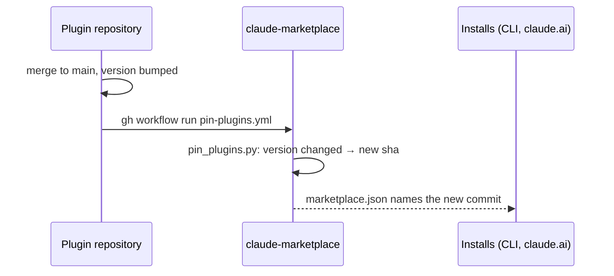

# Publishing a plugin to the marketplace

**A Claude Code plugin of ours is published through Marceltov/claude-marketplace, which pins it to a commit; a change ships by bumping `version` in `.claude-plugin/plugin.json`, and the plugin's repository starts the marketplace's pin workflow itself when that file changes on `main`.** Decided 2026-11-04.

## Why

An install made through claude.ai follows only what the marketplace names: an entry without a pinned commit never updated there (claude-marketplace ADR 0010). The marketplace now pins every GitHub-sourced plugin by `sha` and moves the pin when the plugin's `version` changes, hourly. A new version of engineering-conventions still waited up to an hour, and GitHub runs scheduled workflows late when it is busy (2026-11-04). So our own plugins start the pin themselves (claude-marketplace ADR 0011).

## How



A version bump in the plugin reaches every install about a minute after its merge; the marketplace's hourly run catches anything the trigger missed.

- **The entry** in claude-marketplace's `.claude-plugin/marketplace.json`: `"source": { "source": "github", "repo": "<owner>/<repo>", "sha": "<commit>" }`. The first `sha` is the plugin's current `main`; from then on the workflow moves it.
- **Ship by bumping `version`** in `.claude-plugin/plugin.json`: patch for a wording change, minor for a new or changed rule or feature. A commit without a bump is not pinned and reaches no install.
- **`.github/workflows/pin-in-marketplace.yml`** in the plugin's repository:

  ```yaml
  # A new version starts the marketplace's pin at once (Marceltov/claude-marketplace ADR 0011); its hourly run is the fallback.
  name: Pin in the marketplace

  on:
    push:
      branches: [main]
      paths: [".claude-plugin/plugin.json"]

  permissions: {}

  jobs:
    pin:
      runs-on: ubuntu-latest
      steps:
        - name: Start the marketplace's pin
          run: gh workflow run pin-plugins.yml -R Marceltov/claude-marketplace
          env:
            GH_TOKEN: ${{ secrets.MARKETPLACE_PIN_TOKEN }}
  ```

- **The secret `MARKETPLACE_PIN_TOKEN`** in the plugin's repository: one fine-grained personal access token for all our plugins, on claude-marketplace only, with **Actions: read and write** and nothing else. It may start the pin and may not write code. It is kept in the password manager (see [every secret in the password manager](../repo-setup/secrets.md)); set it from there, never typed or pasted: `op read "<item>/token" | gh secret set MARKETPLACE_PIN_TOKEN -R <owner>/<repo>`, after checking the value is not empty.
- **A new plugin of ours** gets all three in the pull request that adds its entry. A plugin of someone else gets only the entry; the hourly run pins it.

## Rules out

- A GitHub-sourced entry without `sha`.
- A change meant for installs that does not bump `version`.
- A token for the pin with more than Actions on claude-marketplace: Contents write would let a leaked token push code to every install.
- One token per plugin, or a token copied into a repository by hand instead of from the password manager.

## Reference

Marceltov/claude-marketplace: `scripts/pin_plugins.py`, `.github/workflows/pin-plugins.yml`, ADRs 0010 and 0011 (#38, #40, #42). The trigger is in engineering-conventions, trilium-plugin, trilium-llm-wiki, paperless-ngx-plugin and passageway (`.github/workflows/pin-in-marketplace.yml`, 2026-11-04).
