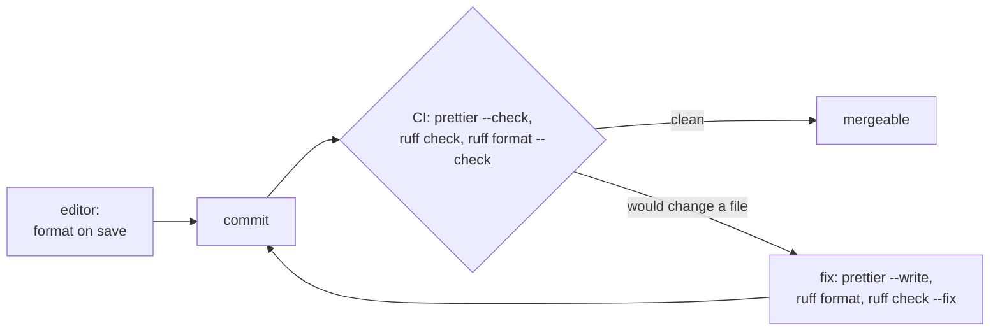

# Formatting and linting

**Lines are 160 columns, everywhere: every language, every configuration file, every tool and every editor.** Decided 2026-10-30.

**Prettier formats everything it can read (TypeScript, JavaScript, CSS, JSON, YAML, Markdown outside a docs site); Ruff lints and formats Python. Both, and `.editorconfig` for every editor, are set to 160. The configuration files are copied from this repository, and CI fails on any file they would change.**

The editor formats as you type; CI is the gate, so a file nobody formatted still can't reach `main`.

## Why

A formatter ends the review comments about layout, and one configuration for every repository means a diff shows what changed, not whose editor touched it. Ruff replaces Black, isort, Flake8 and pyupgrade with one fast tool and one file. 160 columns, not 80: today's screens and side-by-side diffs hold that easily, and at 80 the formatters break calls, signatures and f-strings into towers that are harder to read than the line was.

## How

- **The files**, copied unchanged from the root of [Marceltov/engineering-conventions](https://github.com/Marceltov/engineering-conventions):

    | File | For |
    |---|---|
    | [`.editorconfig`](https://github.com/Marceltov/engineering-conventions/blob/main/.editorconfig) | Every editor and Prettier: `max_line_length = 160`, UTF-8, LF, a final newline, spaces (2; 4 for Python and MkDocs Markdown) |
    | [`.prettierrc.json`](https://github.com/Marceltov/engineering-conventions/blob/main/.prettierrc.json) | Prettier: `printWidth: 160`, everything else Prettier's default |
    | [`.prettierignore`](https://github.com/Marceltov/engineering-conventions/blob/main/.prettierignore) | Leaves out the MkDocs Markdown in `docs/` (below) and the built `site/`; add the project's generated files |
    | [`ruff.toml`](https://github.com/Marceltov/engineering-conventions/blob/main/ruff.toml) | Ruff: `line-length = 160`; lint rules `E`, `F`, `W`, `I`, `UP`, `B`, `SIM`, `RUF`; the formatter's defaults |

    A project adds only what is its own (an extra ignore, a per-file exception with its reason) and keeps the shared lines as they are.

- **160 for anything else that has a line length:** a linter's `max-len`, a shell formatter, an editor's ruler. Nothing is set to 80 or 120.
- **What a tool can't break stays one line:** a Markdown paragraph (one line per paragraph, so the editor wraps it), a URL, a string in JSON, a license text.
- **Installed with the project**, so the lock file holds the version and Dependabot bumps it: `npm install --save-dev prettier` in a Node project, `uv add --dev ruff` in a Python one. A repository with neither runs `npx prettier@3` and `uvx ruff`.
- **Scripts:** in `package.json`, `"format": "prettier --write ."` and `"format:check": "prettier --check ."`; in Python, `uv run ruff format`, `uv run ruff check --fix`. `CLAUDE.md` names them under _Commands_.
- **CI** runs `prettier --check .`, `ruff check` and `ruff format --check` as required checks, next to the tests.
- **ESLint stays** where a Next.js app has it, for what Prettier doesn't do (hooks rules, import boundaries), with [`eslint-config-prettier`](https://github.com/prettier/eslint-config-prettier) last, so no ESLint rule argues with Prettier's layout.
- **The first run is its own pull request:** format the whole repository in one commit that changes nothing else, and add that commit's hash to `.git-blame-ignore-revs`, so `git blame` skips it.
- **Not the Markdown of an MkDocs site.** Python-Markdown needs nested lists and admonition bodies indented by four spaces; Prettier re-indents lists to the marker's width and un-indents the body of `!!! note`, which breaks the page. `.prettierignore` leaves out `docs/**/*.md`; READMEs and `CLAUDE.md` are still formatted.

## Rules out

- Any line length but 160, in any tool or file type, or a project that changes the shared lines of the configuration instead of adding to them.
- Black, isort or Flake8 next to Ruff; ESLint style rules that fight Prettier.
- Formatting changes mixed into a feature's diff.
- A formatter that runs only in editors, without the CI check.
- Prettier on the Markdown of an MkDocs site.

## Reference

This repository: the four files at its root, applied to its hook (`docs_hooks/roadmap.py`), its stylesheet, script and YAML.
