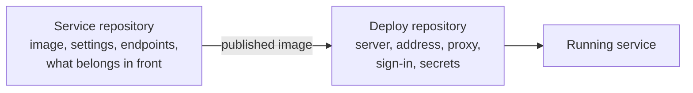

# A service does not know where it runs

**A service's repository says what the service needs and offers, never where it is deployed: no server names, public addresses, reverse proxy or sign-in provider of a real deployment in its README, `CLAUDE.md`, docs or code. Those live in the repository that deploys it.** Decided 2026-11-24.

The service repository describes a service anyone could run; the deploy repository is the one place that says where and how this one runs.

## Why

A service's README named the server it ran on, the proxy, the sign-in provider and the address of its admin page. When that address moved to another domain on 2026-11-24, the service's repository needed a pull request although nothing in the service changed. Every deployment detail in a service repository is a second copy of what the deploy repository already says, and it goes stale the next time the deployment changes ([Docs live with the code](docs-live-with-the-code.md): the same instructions in two places).

## How

- **Describe what the service offers and needs, in general terms.** "`/control`: one page with one button; it needs the control token, so it belongs behind a sign-in, with the proxy adding the token" instead of "`admin.example.com`, behind our SSO on server-1".
- **Settings name what they are, not where they point.** `.env.example` holds placeholders (`https://invoices.example.com`); the real values are in the deploy repository and the password manager ([Every secret in the password manager](secrets.md)).
- **A diagram shows the service's parts and its neighbours by role** ("reverse proxy", "sign-in"), not by host.
- **What the service is for may stay.** The product or website it serves is its purpose, not its deployment: a bridge for one shop's website may name that website and allow it as an origin. When it could serve several, it becomes a setting.
- **The deploy repository** (Ansible, the stacks repository) holds the server, the address, the proxy configuration, the sign-in setup and the dashboards that link to it, and documents them there.

## Rules out

- A server's name, a public or internal address, or a named proxy or sign-in provider of a real deployment in a service's README, `CLAUDE.md`, docs or code.
- A pull request to a service's repository only because its deployment moved.
- Rewriting ADRs, design records or changelogs to remove such names: they are dated records of what was decided then, and may name what existed.

## Reference

3D-Bruckner/print-bridge#16: the README and `CLAUDE.md` stopped naming the server, the proxy, the sign-in and the hide page's address; the address moved in the deploy repository alone (MarcelBruckner-Business/ansible#103).
