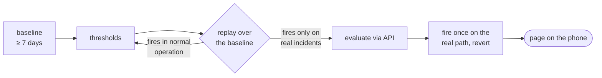

# Alerts that reach a person

**An alert rule is done when a person has received it: every rule is fired once on its real path, its thresholds come from a measured baseline, and its message fits the channel it goes to. A rule that is provisioned and green proves nothing.** Decided 2026-11-04.

## Why

On 2026-11-04 four new capacity rules were built for one monitoring setup and fired once each before being called done. The firing found four faults that nothing else showed: a math expression that returned its input unchanged, so a rule went pending with plenty of headroom; rules that sat in "Normal (NoData)" whatever the values, because Grafana's threshold gave no output for multi-series results without a time column; a summary the deploy check refused for a double quote; and a group of 44 alerts sent as one 8 KB message, which ntfy answered with a 500, so the page never arrived. Every rule was provisioned, healthy and green throughout.

The thresholds the plan proposed ("set them so nothing fires over the baseline week") would have missed the one real squeeze that happened inside that week, the incident the rules were written for. Earlier, three controls in the same setup had never delivered a single alert while every liveness check stayed green.

## How

- **Measure before choosing.** Take at least 7 days of the metric the rule reads, at the resolution the rule evaluates. Record min, p1, p5 and median (or max and p99 for "bad when high"). Read the incidents inside the window: a real incident is a case the rule must catch, not noise to tune away.
- **Replay the condition** over the whole window with its `for` duration (Flux `stateDuration`, PromQL over a range). It must stay quiet in normal operation and fire on every real incident in the window. Write the numbers into the ADR that records the rule.
- **Check the rule before deploying it.** Run its data blocks through Grafana's evaluation endpoint (`POST /api/v1/eval` with the rule's `data` and `condition`), as written and with the threshold loosened so it must fire. A condition that never produces a value shows up here, not in production.
- **Multi-series rules return time series.** One row per series with a `_time`, then a Reduce (`last`), then a Threshold. Compute boolean conditions inside the query (1 or 0) instead of in a math expression across queries.
- **Silence is a rule of its own.** A query that returns nothing must page (`noDataState: Alerting`), or compare against a list of what is expected to report. Per-series rules use `noDataState: OK` only when such a rule exists.
- **Fire every rule once on its real path.** On a branch, loosen the threshold so current values breach it, deploy the normal way, see the page arrive on the phone, revert. Do it again after changing a contact point, a template or a route. Note the delivery time in the ADR.
- **Messages fit the channel.** ntfy drops a JSON message over about 4 KB.
  - Group per rule (`group_by: [grafana_folder, alertname]` or by the label the rule is about), never everything in one group.
  - The template lists at most 5 alerts, then the total.
  - Summaries stay under 700 characters, carry no `"` or `\` inside a JSON template, and are checked by the deploy.
  - A resolved alert is one line: its name and what it was about, not its firing summary.
- **Every rule says what it catches and what else would catch it,** in a comment beside it. If nothing good answers either question, the rule is a deletion candidate.

## Rules out

- Calling a rule done because it is provisioned, healthy or green.
- A threshold that was guessed, or tuned so that nothing fires over a window that contains a real incident.
- A template that lists every alert of a group without a cap, or a root policy that puts every alert into one group.
- A math expression as a rule's only condition, unchecked by the evaluation endpoint.
- A resolved message that repeats the firing summary.

## Reference

The homelab's monitoring repository (capacity rules, the 5-alert ntfy cap, per-rule grouping and the deploy-time summary check, 2026-11-04; its ADR records the baseline and each delivery time). Both it and the business's stacks repository, where it is to be applied, are private.
