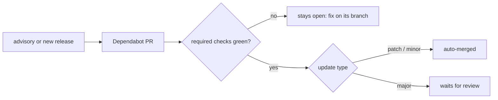

# Dependabot with auto-merge

**Every repository gets Dependabot: dependency bumps arrive as pull requests, security fixes as soon as an advisory is known. Patch and minor bumps, security fixes included, merge by themselves once CI is green; majors wait for review.** Decided 2026-10-27.

CI is the gate for everything; the update type only decides whether a person also has to look.

## Why

A scheduled audit only reports advisories; the fix still has to be made by hand. On 2026-10-26 notefeed's audit went red with remote-code-execution advisories in `next` and high ones in the MCP SDK. Ready-to-merge bumps that merge by themselves when tests pass close that gap. Dependabot over Renovate: it is built into GitHub, so no third-party app gets write access, and it has `cooldown` and `groups`.

## How

1. **Switch it on** per repository: `gh api -X PUT repos/<owner>/<repo>/vulnerability-alerts` and `gh api -X PUT repos/<owner>/<repo>/automated-security-fixes`.
2. **`.github/dependabot.yml`**, one entry per ecosystem (npm, uv/pip, docker, github-actions), each with:
    - `schedule`: weekly, Monday 05:00, `timezone: Europe/Berlin`;
    - `cooldown: default-days: 14`: a release must be two weeks old before it is proposed (security updates skip it);
    - `groups`: one for minor and patch bumps; packages that move together (Next.js and `eslint-config-next`) in their own group, listed first; majors one pull request each;
    - `commit-message: prefix: Dependencies`, `labels: [dependencies]`, `open-pull-requests-limit: 5`;
    - `ignore` for what is upgraded by hand on purpose: the Node major (moves with `.nvmrc` and the Dockerfile), a database major such as Postgres;
    - no YAML anchors or extra top-level keys.
3. **Auto-merge**, all three parts:
    - allow it: `gh api -X PATCH repos/<owner>/<repo> -F allow_auto_merge=true`;
    - **require the CI checks on the default branch** with a ruleset (`required_status_checks`, `~DEFAULT_BRANCH`, the admin role as bypass actor). Without required checks, `gh pr merge --auto` doesn't wait: it merges at once;
    - `.github/workflows/dependabot-automerge.yml`: on `pull_request`, only for `dependabot[bot]`, `dependabot/fetch-metadata@v2`, then `gh pr merge --auto --merge` for `version-update:semver-patch` and `-minor`; permissions `contents: write`, `pull-requests: write`.
4. **`CLAUDE.md`** names this as the one exception to "merge only when I say so".
5. **Keep a scheduled audit** (`npm audit --omit=dev`, `pip-audit`, an image scan) as a safety net.
6. When a codegen tool is bumped and CI fails on stale generated code, regenerate on the Dependabot branch.

**Caveats:** a merge by the workflow's `GITHUB_TOKEN` starts no further workflows, so a push-to-main job doesn't run for it. Dependabot pull requests get Dependabot's secrets, not the Actions secrets. Security updates don't always open a pull request: check `gh api repos/<owner>/<repo>/dependabot/alerts` after switching it on.

## Rules out

- A repository without Dependabot, or auto-merge without required checks.
- Auto-merging majors.
- Renovate or another third-party bot with write access.

## Reference

notefeed (notefeed/notefeed#266): `.github/dependabot.yml`, the auto-merge workflow and the `CLAUDE.md` note.
