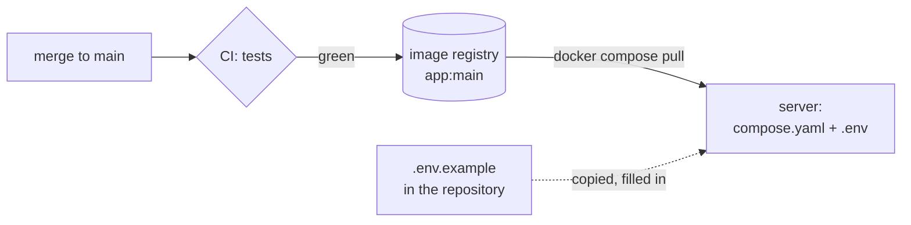

# Deploying with Docker Compose

**A self-hosted app is deployed from its published image, with Docker Compose and one `.env` file. The server holds only `compose.yaml` and `.env`: nothing is cloned or built there, and every setting, secrets included, is in the `.env` file.** Decided 2026-10-30.



Only an image that passed CI reaches the server; the repository gives the server two files, and the server adds its secrets to one of them.

## Why

Building on the server needs the source, a toolchain and minutes per deploy, and what runs is then not the image CI tested. Settings listed one by one in `compose.yaml` (`APP_FOO: ${APP_FOO:-}`) have to change with every new variable, in the repository and on every server, and one forgotten line silently drops a setting. One `.env` file is the one place a server's settings live. Decided while deploying questlog for the first time (2026-10-30).

## How

- **CI publishes the image.** A push to `main` publishes `ghcr.io/<owner>/<app>:main` once the tests passed; a version tag publishes the version tags ([Releases](releases.md)). The package is public, or the server logs in to the registry.
- **`compose.yaml` in the repository is the one the server runs:** `image:`, not `build:`; `env_file: .env`; one volume for `DATA_DIR`; `restart: unless-stopped`; the port.

    ```yaml
    services:
      app:
        image: ghcr.io/<owner>/<app>:main
        restart: unless-stopped
        ports:
          - "3000:3000"
        env_file: .env
        volumes:
          - app-data:/data

    volumes:
      app-data:
    ```

- **`.env.example` lists every variable** with a comment: what it does, its default, whether it is required. The server's `.env` is a copy of it, filled in, readable only by its owner (`chmod 600`), never committed (`.gitignore`: `.env*` and `!.env.example`).
- **A copy of `.env.example` starts as it is.** A variable whose empty value would override the image's default (`DATA_DIR`, `PORT`), and an example block that is only valid when complete (an OIDC provider), stays commented out until it is filled in.
- **Deploy and update:** put the two files in a folder on the server, then `docker compose pull && docker compose up -d`. An image watcher (Watchtower) on the server may do the same on its schedule. A server that shouldn't follow `main` pins a version tag (`:X.Y`) instead.
- **In front:** a reverse proxy terminates TLS; the app's public address (`PUBLIC_URL`) is the proxy's.
- **Files that change together:** the app's config module, `.env.example` and the configuration docs. `compose.yaml` doesn't list variables, so a new setting doesn't touch it.

## Rules out

- Cloning or building on the server; `build:` in the `compose.yaml` a server runs.
- Variables listed one by one in `compose.yaml`; settings or secrets in `compose.yaml` or baked into the image.
- A committed `.env`; a variable the app reads that `.env.example` doesn't list.
- An `.env.example` whose unchanged copy overrides the image's defaults or keeps the app from starting.
- Deploying an image that didn't pass CI.

## Reference

questlog (Marceltov/questlog#15: `compose.yaml` with `env_file`, `.env.example` as the server's template); freundebuch (the image published by CI on every push to `main`).
