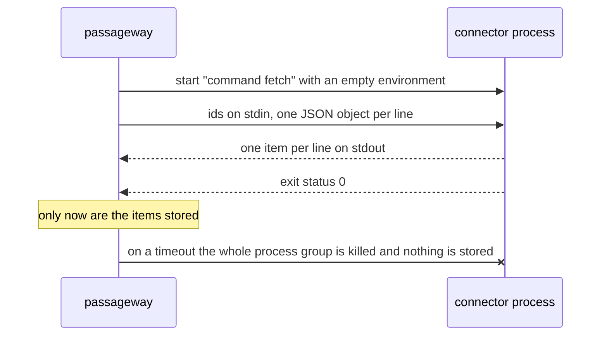

# Diagrams

**Whatever has a shape is drawn as a Mermaid diagram in the Markdown page: the pieces of a system, a sequence of calls, a flow with decisions, the states something moves through. Every page that explains how something works has one. Each diagram is small, its arrows are labelled, one sentence next to it says how to read it, and it is drawn in the site's own palette.**

## Why

A paragraph about five components and their connections makes the reader draw the picture themselves. A diagram in the page shows it at a glance, and because Mermaid is text, it is reviewed, diffed and kept current with the prose around it. Pictures exported from a drawing tool go stale, because nobody can edit them in a pull request.

## How

Pick the diagram by what it shows:

| To show … | Use |
|---|---|
| The pieces of a system and what flows between them | `flowchart LR`, with a `subgraph` per boundary (process, service) |
| A call or a protocol between processes, in order | `sequenceDiagram`, with `Note over` for what happens only at the end |
| A decision or a pipeline with branches | `flowchart TD`, with `{…}` for each question and labelled `yes` / `no` edges |
| States something moves through | `stateDiagram-v2` |

An example, from passageway's _How it works_:



The core starts the connector, feeds it ids, and stores nothing until the process has exited cleanly.

- **Small:** under about 15 nodes. A bigger picture is two diagrams.
- **Labels are words from the page**, short, with `<br/>` to break long ones; every arrow that isn't obvious says what flows.
- **One sentence of reading** right after it: what to look at first.
- **No colours or styles in the diagram itself** (`style`, `classDef`, `%%{init}%%`): the site's palette colours every diagram, in light and dark mode (below).
- **Configuration** in `mkdocs.yml`:

    ```yaml
    markdown_extensions:
      - pymdownx.superfences:
          custom_fences:
            - name: mermaid
              class: mermaid
              format: !!python/name:pymdownx.superfences.fence_code_format
    ```

    Material renders the fence; GitHub renders the same block in the Markdown view, so ADRs and READMEs show it too.
- **Where they belong:** the home page shows the main flow (a `sequenceDiagram` of what happens when the product is used); a _How it works_ or reference page shows the pieces and the decisions; an ADR shows the structure it decides; a guide shows the flow it sets up.

## In the site's palette

Material colours Mermaid through `--md-mermaid-*` CSS variables. Set them in `docs/stylesheets/extra.css` from the site's own tokens, once, so they follow light and dark mode:

```css
:root > * {
  --md-mermaid-edge-color: var(--xx-accent);
  --md-mermaid-node-bg-color: var(--xx-mist);
  --md-mermaid-node-fg-color: var(--xx-ink);
  --md-mermaid-label-bg-color: var(--md-default-bg-color);
  --md-mermaid-label-fg-color: var(--xx-ink);
  --md-mermaid-sequence-actor-bg-color: var(--xx-mist);
  --md-mermaid-sequence-actor-border-color: var(--xx-accent);
  --md-mermaid-sequence-actor-line-color: var(--md-default-fg-color--lighter);
  --md-mermaid-sequence-message-line-color: var(--xx-accent);
  --md-mermaid-sequence-message-fg-color: var(--xx-ink);
  --md-mermaid-sequence-note-bg-color: var(--xx-mist);
  --md-mermaid-sequence-note-border-color: var(--xx-accent);
  --md-mermaid-sequence-number-bg-color: var(--xx-accent);
  /* … and the rest of the sequence-* variables the same way */
}
```

Material 9 loads the newest Mermaid 11, and some of its styles predate it: arrowheads and lifelines then keep Mermaid's purple and grey. So **pin Mermaid and add the missing rules** with `docs/javascripts/mermaid.js`, which appends them to Material's theme CSS before it initialises Mermaid:

```yaml
extra_javascript:
  - https://unpkg.com/mermaid@11.17.2/dist/mermaid.min.js
  - javascripts/mermaid.js
```

```js
(() => {
  if (typeof mermaid === "undefined") return;
  const rules = `
    .actor-line { stroke: var(--md-mermaid-sequence-actor-line-color) !important; }
    marker[id$="arrowhead"] path { fill: var(--md-mermaid-sequence-message-line-color) !important; stroke: none !important; }
    marker[id$="crosshead"] path { stroke: var(--md-mermaid-sequence-message-line-color) !important; }
    .cluster rect { fill: var(--md-default-bg-color) !important; stroke: var(--md-mermaid-edge-color) !important; stroke-dasharray: 4 3; }
    .edgeLabel, .edgeLabel p { color: var(--md-mermaid-label-fg-color); }
  `;
  const initialize = mermaid.initialize.bind(mermaid);
  mermaid.initialize = (config = {}) => initialize({ ...config, themeCSS: (config.themeCSS ?? "") + rules });
})();
```

**Check every diagram in a screenshot, light and dark**: the arrowheads, the lifelines and the group boxes are where the defaults show through. A build where Mermaid can't load shows the source instead; serve the pinned file locally for the screenshot.

## Rules out

- Exported images (PNG, SVG from a drawing tool) for something Mermaid can draw.
- ASCII art for architecture or flows.
- A diagram with no reading sentence, unlabelled arrows, or more than about 15 nodes.
- Styling diagrams by hand (`style`, `classDef`, `%%{init}%%`) so that one theme looks wrong.
- A site whose diagrams show Mermaid's default purple, grey or black instead of its palette.
- A page that explains a sequence, a flow or a structure only in prose.
- Unpinned Mermaid.

## Reference

passageway (`docs/how-it-works.md`: a `flowchart LR` with subgraphs, a `sequenceDiagram`, a `flowchart TD` for ranking); freundebuch (`docs/internals/how-it-works.md`); [mcp-login-oauth](https://mcp-login-oauth.marceltov.de/) (the sign-in sequence on its home page, how `verify` decides, and the TypeScript setup; the palette variables and `javascripts/mermaid.js`).
