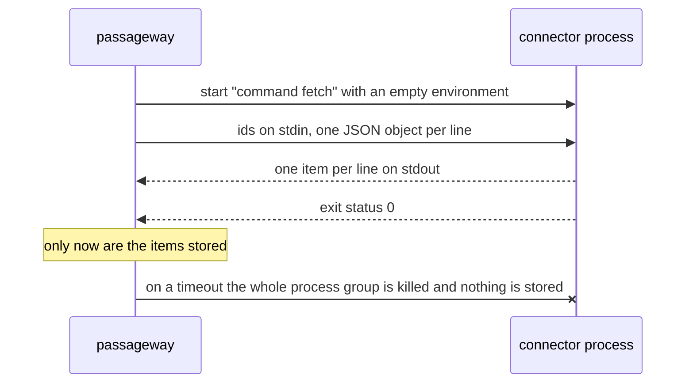

# Diagrams

**Whatever has a shape is drawn as a Mermaid diagram in the Markdown page: the pieces of a system, a call between processes, a decision with branches. Each diagram is small, its arrows are labelled, and one sentence next to it says how to read it.**

## Why

A paragraph about five components and their connections makes the reader draw the picture themselves. A diagram in the page shows it at a glance, and because Mermaid is text, it is reviewed, diffed and kept current with the prose around it. Pictures exported from a drawing tool go stale, because nobody can edit them in a pull request.

## How

Pick the diagram by what it shows:

| To show … | Use |
|---|---|
| The pieces of a system and what flows between them | `flowchart LR`, with a `subgraph` per boundary (process, service) |
| A call or a protocol between processes, in order | `sequenceDiagram`, with `Note over` for what happens only at the end |
| A decision or a pipeline with branches | `flowchart TD`, with `{…}` for each question and labelled `yes` / `no` edges |
| States something moves through | `stateDiagram-v2` |

An example, from passageway's _How it works_:



The core starts the connector, feeds it ids, and stores nothing until the process has exited cleanly.

- **Small:** under about 15 nodes. A bigger picture is two diagrams.
- **Labels are words from the page**, short, with `<br/>` to break long ones; every arrow that isn't obvious says what flows.
- **One sentence of reading** right after it: what to look at first.
- **No colours or styles in the diagram**; the site's theme renders it in light and dark.
- **Configuration** in `mkdocs.yml`:

    ```yaml
    markdown_extensions:
      - pymdownx.superfences:
          custom_fences:
            - name: mermaid
              class: mermaid
              format: !!python/name:pymdownx.superfences.fence_code_format
    ```

    Material renders the fence; GitHub renders the same block in the Markdown view, so ADRs and READMEs show it too.
- **ADRs, `how-it-works` pages and READMEs** use them where a structure is decided or explained.

## Rules out

- Exported images (PNG, SVG from a drawing tool) for something Mermaid can draw.
- ASCII art for architecture or flows.
- A diagram with no reading sentence, unlabelled arrows, or more than about 15 nodes.
- Styling diagrams by hand (`style`, `classDef`) so that one theme looks wrong.

## Reference

passageway (`docs/how-it-works.md`: a `flowchart LR` with subgraphs, a `sequenceDiagram`, a `flowchart TD` for ranking); freundebuch (`docs/internals/how-it-works.md`); mcp-login-oauth (the sign-in sequence on its home page and how `verify` decides).
