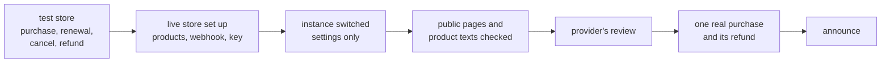

# Going live with a payment provider

**A hosted instance sells from the provider's test store until a purchase, a renewal, a cancel and a refund have gone through, then moves to the live store by settings alone. Before the provider is asked to review the store, the instance shows its prices, terms, privacy policy, imprint and a support address without sign-in, and the product texts have been looked at on a test checkout.** Decided 2026-11-11.

The review comes late and only once; everything it looks at is in place before it is asked for.

## Why

Gamepanion moved its hosted instance from Creem's test store to its live store on 2026-11-11. Four things came up that the next product would run into again:

- **The review gates every live payment.** Until Creem has approved the store, a live checkout answers "Live payments are not enabled for your account". A rejected review blocks a new one for three months (Creem's rule in November 2026), so the first request has to pass.
- **The review looks at the site as a stranger.** It asks for visible pricing, terms, a privacy policy and a way to reach support. Gamepanion's plans were only on the page behind the sign-in.
- **Product texts are Markdown.** Descriptions written as plain text with one line per benefit ran together into one paragraph on the checkout: Creem folds single line breaks.
- **The live store is a second store.** Its products, its webhook, the webhook's secret and the API key all differ from the test store's, so every one of those settings changes at the switch.

## How

- **Test store first.** Tests and development run on the fake provider ([selling a hosted instance](../architecture/payments.md)); the hosted instance runs on the provider's test store until a purchase, a renewal, a cancel in the portal and a refund have each arrived as a webhook and changed access as expected.
- **The live store is set up again, not copied:** the same products (name, price, period, tax mode, description) and one webhook to the instance's webhook route. Its API key, the webhook's secret and the product ids go into the password manager ([secrets](secrets.md)) and from there into the server's `.env`.
- **One key per command.** A command against a store gets that store's key in its own environment, read from the password manager (`CREEM_API_KEY=… creem products update <id> --environment live`), instead of switching the CLI's stored sign-in. No later command lands in the wrong store.
- **The switch is settings and a deploy,** no release: the provider's settings in `.env` get the live values, all of them at once. The change is on the deployment repository's main branch before anyone deploys again; a deploy from the old state puts the instance back on the test store.
- **Purchases from the test store don't come along.** Their rows point at subscriptions the live store doesn't know. Delete those rows before the switch, not the file they are in, which may hold other things.
- **Product texts are written as Markdown:** a bold line that says what it is, a list of what the buyer gets, then how it renews, how to cancel and what the refund terms are. Change a text on the test store first, open a test checkout and look at it, then give the live product the same text. The texts are kept in the operator guide ([operator pages](operator-pages.md)).
- **Before asking for the review,** open the instance in a private window, signed out, and find:

    | What | Where |
    |---|---|
    | The plans and their prices | the public pricing page ([selling a hosted instance](../architecture/payments.md)) |
    | Terms, privacy policy, imprint | the footer ([operator pages](operator-pages.md)) |
    | A support address a person reads | the imprint and the terms ([mail](mail.md)) |
    | What the product is | the start or sign-in page |

    Then start a checkout from the live store: it must open and refuse the payment with the provider's "not enabled" message. That shows the key, the products and the checkout work, and only the review is missing.

- **After the approval,** buy once with a real card, watch the webhook arrive and access open, refund it and watch access end. Only then are the paid plans announced.
- **The operator guide** records the date of the switch, the store's and products' ids, the webhook's id, the item in the password manager and the product texts: ids and names, never a secret's value.

## Rules out

- Asking for the provider's review while prices, terms, privacy policy, imprint or the support address are missing or need a sign-in.
- A product text changed on the live store that nobody has seen on a test checkout.
- A release or a code change to move from the test store to the live store.
- A test-store key or product id left in the live instance's settings; purchases from the test store in the live instance's billing store.
- Switching a CLI's stored sign-in between stores to run one command.
- Announcing paid plans before one real purchase and its refund went through.

## Reference

Gamepanion: its hosted instance on Creem's live store since 2026-11-11 (settings from the deployment repository, product texts in its operator guide), and the public pricing page `app/(site)/pricing/`. notefeed's pricing page, `/license`, is public as well (`app/(site)/license/`).
