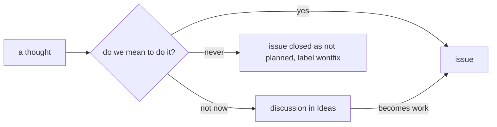

# Issues and ideas

**An open issue is work we mean to do. An idea we don't plan to build now is a discussion in the category _Ideas_; when it becomes work, an issue is made from it. `wontfix` means we won't do it, not "maybe later".** Decided 2026-11-13.

The issue list is the work list; ideas stay findable, but out of it.

## Why

On 2026-11-13 noticebox's issues mixed work in progress with ideas weighed and set aside the same day (a malware scan of uploads, an S3 store for files). Open, they read as work nobody does; closed as "not planned", they read as rejected and are hard to find again. An idea is something to talk about until someone decides to build it, which is what Discussions are for.

## How

- **Turn Discussions on** in each repository (Settings → Features → Discussions, or `gh repo edit --enable-discussions`). GitHub creates an _Ideas_ category with them; use it, don't add another.
- **File an idea** as a discussion in _Ideas_: what it is, what it would bring, what it costs, and why not now, with the date it was weighed. The reasoning is what makes it worth reading later.
- **An issue that turns out to be an idea** moves: write the discussion (GitHub's "Convert to discussion" works too), comment on the issue with its link, close the issue as _not planned_.
- **When an idea becomes work**, open an issue from the discussion ("Create issue from discussion") and link both ways. The discussion stays as the record of how it was weighed.
- **`wontfix`** is for a request we decided against for good, closed as _not planned_ with the reason; the triage labels (`needs-triage`, `needs-info`, `ready-for-agent`, `ready-for-human`) are for issues only.

## Rules out

- Open issues for ideas nobody plans to build, labelled `idea` or otherwise.
- Closing an idea as `wontfix` to get it out of the list.
- An _Ideas_ discussion without the reason it waits.

## Reference

noticebox: Discussions turned on, the malware-scan issue moved to [discussion #105](https://github.com/noticebox/noticebox/discussions/105), the S3 idea filed as [discussion #104](https://github.com/noticebox/noticebox/discussions/104).
