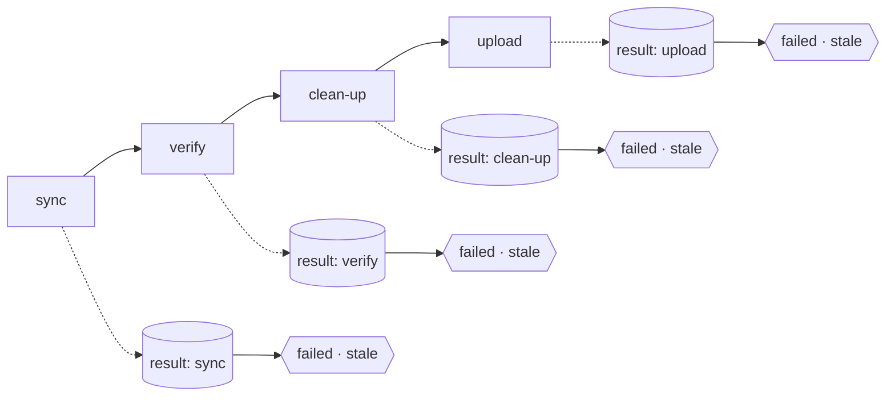

# Every job watched on its own

**Every job reports its own outcome, and every job is watched for its absence. A scheduled or chained job writes one result per run, labelled by job and target. Each job gets two alerts: _failed_ (the last run failed) and _stale_ (no success within its interval plus a margin). The stale alert reads a value that exists even when the job did not run, and no alert infers one job's health from another's.** Decided 2026-11-18.

Each step of a chain writes its own result and has its own two alerts. When the chain dies after `sync`, the later steps' stale alerts fire, even though nothing ran that could fail.

## Why

On 2026-11-18 a review of one backup setup found four jobs with only a _failed_ alert: two clean-up jobs, a verify job and a garbage collection. Three of them ran inside a chain. A reboot the day before had killed the chain partway through, so the steps after it never ran. A job that never runs cannot fail, so nothing paged for those steps. The steps that did page were the ones whose own results had stopped arriving.

The same review found two _stale_ alerts that went quiet by themselves. Each looked back over a fixed window (7 and 30 days) for the last success. Once a job had not succeeded inside that window, its series vanished from the query result. Grafana counts a vanished series as resolved, so a week of failed uploads ended in silence.

## How

- **One result per run, per job and target.** Write it where the alerts can read it: a metric with `job` and `target` labels, or a log line with a fixed marker (`<job>: ok`, `<job>: FAILED <reason>`). A chain writes one result per step, not one for the whole chain.
- **A failed alert per job.** It reads the last result of each job and target.
- **A stale alert per job, from a value that is always there.** The rule needs the list of what it expects, from something that does not depend on the job having run:
  - the targets a collector writes on every poll (the datastores it sees, the hosts it reads), crossed with the jobs each one should run;
  - a list rendered from the deployment's inventory into the rule, so a job that never ran is in the result with no success.

  Then read each key's last success over the store's whole history, not a look-back window, and give a key with no success a time of zero, so that it reads as infinitely old. In a log query, a per-job `… or vector(0)` term does the same.
- **Choose the threshold from measured gaps.** Take the longest gap between two successes over at least 30 days, and set the limit just above it. A longer gap inside that window is an incident the rule must catch, not noise to tune away (see [Alerts that reach a person](alerting.md)).
- **A rule over a single log marker needs `noDataState: Alerting`.** This is the only case where an empty result means "stale".
- **Check the fallback where it runs.** A fallback that is right on one data source can be wrong across several: in Loki, `or vector(0)` over a multi-tenant query returned the fallback instead of the real count in 6 of 8 identical runs. Repeat the query before trusting it, and keep stale rules on single-tenant queries.
- **Jobs that run inside an app** (a cron container, an in-process scheduler) report the same way. The app logs or exports the result itself, not the container's liveness.
- **A step that must not stop the others still reports.** When a loop over targets ignores one target's failure so the rest run, make it print `ok` or `FAILED` per target, and end with one `ok` for the run.

## Rules out

- A job whose only alert is _failed_.
- A stale alert computed over a fixed look-back window, where a long enough outage makes the series drop out and the alert resolve.
- Inferring a job's health from another job: "the upload ran, so the verify ran", or "the chain finished, so every step did".
- Treating a container that is up, or a timer that is active, as the job's success.

## Reference

The homelab's management repository, 2026-11-18 (private).
- **Backups:** every prune, garbage collection and verify job, per datastore, is checked against the datastores the backup collector writes every five minutes. Each offsite upload is checked against every upload job ever reported, in a store that keeps everything.
- **Fleet:** Watchtower, unattended upgrades, the hypervisors' guest housekeeping and an app's 13 cron endpoints are covered by one stale rule per host, its job list rendered from the inventory, plus one failed rule per job.
