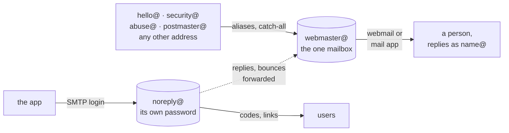

# Mail on a product's domain

**A product's domain has one mailbox people read: the mail package's built-in address (`webmaster@` or the like) as a catch-all, with the role addresses as aliases on it, answered from the person's own address. The app sends through the package's SMTP from a second mailbox of its own, with its own password.** Decided 2026-11-01.



Everything sent to the domain lands in one place a person reads; the app's mail goes out through a mailbox that holds nothing else.

## Why

An app with sign-in by code or link needs to send mail, and a product with its own domain needs addresses people can write to: the Impressum needs one, and security reports and abuse complaints go to `security@` and `abuse@` (RFC 2142). A separate mail service per product is one more account, contract and set of DNS records, while the domain's mail package already has mailboxes and SMTP, and an app's sign-in mail is far below its limits. The app's SMTP password sits in the server's `.env` with every other setting ([Deploying](deployment.md)); if it were the password of the mailbox people read, whoever gets the `.env` would read all of the product's mail. Decided while setting up Gamepanion's domain (2026-11-01).

## How

- **One mailbox to read:** the package's built-in address, often one that can't be deleted (`webmaster@`). Set it as the catch-all, so mail to a mistyped or new address isn't lost, and read it in the package's webmail or the local mail app.
- **Role addresses are aliases on it:** `hello@` (Impressum, support, the contact on the product's pages), `security@`, `abuse@`, `postmaster@`, and the person's own `name@`. Replies go out as `name@`, never as `webmaster@`.
- **The app's own mailbox:** `noreply@`, with its own password, used only as the app's SMTP login. It forwards what it receives (replies, bounces) to the one mailbox.
- **The app's settings**, in the server's `.env`, as on [Better Auth](../stacks/better-auth.md) (the `@` of the login written as `%40`):

    ```dotenv
    <APP>_SMTP_URL=smtps://noreply%40<domain>:<password>@<package's SMTP host>:465
    <APP>_SMTP_FROM=<Product> <noreply@<domain>>
    ```

- **DNS:** SPF and DKIM for the package's mail servers, as the package's DNS settings offer them, and DMARC as TXT on `_dmarc`: `v=DMARC1; p=quarantine; rua=mailto:postmaster@<domain>`.
- **Check** with one real sign-in mail to an outside address: it arrives, not as spam, and its headers show SPF, DKIM and DMARC as `pass`.

## Rules out

- The app logging in to SMTP as the mailbox people read, or sharing its password.
- A mail service of its own per product while the domain's mail package can send the app's mail.
- Addresses on a product's pages that aren't aliases of its one mailbox, such as a personal address on another domain.
- Replying as `webmaster@` or `noreply@`.
- Sending from a domain without SPF, DKIM and DMARC.

## Reference

Gamepanion (`gamepanion.app`): being set up this way since 2026-11-01; its sign-in codes and links will be sent from `noreply@`.
