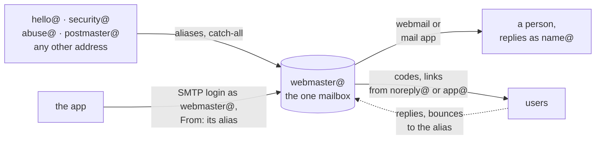

# Mail on a product's domain

**A product's domain has one mailbox people read: the mail package's built-in address (`webmaster@` or the like) as a catch-all, with the role addresses as aliases on it, answered from the person's own address. The app logs in to the package's SMTP as that one mailbox and sends from an alias of its own (`noreply@`, or its name, such as `planner@`).** Decided 2026-11-01; changed 2026-11-26: no second mailbox for the app.



Everything sent to the domain lands in one place a person reads, the app's replies and bounces included; the app's mail goes out through the same mailbox under its own address.

## Why

An app with sign-in by code or link needs to send mail, and a product with its own domain needs addresses people can write to: the Impressum needs one, and security reports and abuse complaints go to `security@` and `abuse@` (RFC 2142). A separate mail service per product is one more account, contract and set of DNS records, while the domain's mail package already has mailboxes and SMTP, and an app's sign-in mail is far below its limits. Decided while setting up Gamepanion's domain (2026-11-01).

A second mailbox per app (`noreply@` with its own password, as decided first) meant one more mailbox, password and forward to set up and keep per app, for one person who reads all of the mail anyway. Changed while setting up the business planner's sign-in mail (2026-11-26): the app logs in as the one mailbox and sends as its alias. The cost: whoever gets the app's `.env` can read the domain's mail, so the `.env` is kept like any other secret ([Secrets](secrets.md)).

## How

- **One mailbox to read:** the package's built-in address, often one that can't be deleted (`webmaster@`). Set it as the catch-all, so mail to a mistyped or new address isn't lost, and read it in the package's webmail or the local mail app.
- **Role addresses are aliases on it:** `hello@` (Impressum, support, the contact on the product's pages), `security@`, `abuse@`, `postmaster@`, and the person's own `name@`. Replies go out as `name@`, never as `webmaster@`.
- **The app's address is an alias too:** `noreply@`, or the app's name (`planner@`), on the one mailbox. The app logs in to SMTP as the one mailbox, with its password, and sends from the alias; replies and bounces to it land in the one mailbox.
- **The app's settings**, in the server's `.env`, as on [Better Auth](../stacks/better-auth.md) (the `@` of the login written as `%40`):

    ```dotenv
    <APP>_SMTP_URL=smtps://webmaster%40<domain>:<password>@<package's SMTP host>:465
    <APP>_SMTP_FROM=<Product> <noreply@<domain>>
    ```

- **DNS:** SPF and DKIM for the package's mail servers, as the package's DNS settings offer them, and DMARC as TXT on `_dmarc`: `v=DMARC1; p=quarantine; rua=mailto:postmaster@<domain>`.
- **Check** with one real sign-in mail to an outside address: it arrives, not as spam, and its headers show SPF, DKIM and DMARC as `pass`.

## Rules out

- A mailbox of its own per app, with a password to keep and a forward to set up.
- The app sending as `webmaster@`, or from an address that isn't an alias of the one mailbox.
- A mail service of its own per product while the domain's mail package can send the app's mail.
- Addresses on a product's pages that aren't aliases of its one mailbox, such as a personal address on another domain.
- A person replying as `webmaster@` or as the app's alias.
- Sending from a domain without SPF, DKIM and DMARC.

## Reference

The business's planner (a private repository): being set up this way since 2026-11-26, logging in as `webmaster@` and sending its sign-in links as `planner@`. Gamepanion (`gamepanion.app`) was set up with its own `noreply@` mailbox on 2026-11-01, before this change.
