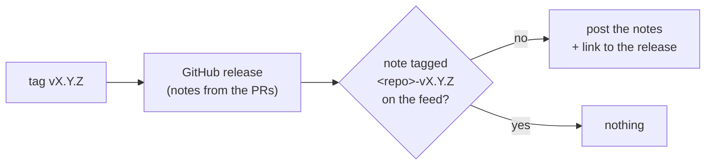

# Releases

**A release is a version tag `vX.Y.Z` on `main`. CI builds and tags the image (`X.Y.Z`, `X.Y`, `latest`) and makes the GitHub release from the pull requests merged since the last tag.** Every tool we make also posts each release's notes to its own feed on [notefeed](https://notefeed.me), once per tag. Decided 2026-11-13.

## Why

A tag is a single, reviewable act: what is released is exactly what is on `main` at that commit, and the release notes come from the pull requests that already describe each change. Nothing is published from a laptop.

GitHub's release list is only read by people who already watch the repository. A notefeed feed can be read in the browser, followed by RSS and queried by an AI assistant over MCP, so the people who use a tool hear about its releases without a GitHub account. notefeed, passageway and the Trilium projects already did this, each with the same few lines; on 2026-11-13 it became the rule for every tool, so that no release goes out unannounced.

## How

- Tag `main`: `git tag -a vX.Y.Z -m "vX.Y.Z" && git push origin vX.Y.Z`.
- The release workflow checks that the tag matches the version in the project (`package.json`, `pyproject.toml`) before it builds.
- The image gets three tags: the exact version, the minor line and `latest`.
- **A Python library goes to PyPI** from the same tag, through [Trusted Publishing](https://docs.pypi.org/trusted-publishers/): the workflow publishes with a short-lived token bound to the repository, the workflow file and an environment named `pypi`, so no API token is stored anywhere. The workflow checks that the tag matches `pyproject.toml`, runs the tests, runs `uv build`, publishes with `pypa/gh-action-pypi-publish` and attaches the same files to the GitHub release.
- The release carries an SBOM (CycloneDX, the dependencies and the image) and the image an SBOM and a build provenance: [Security setup](security.md).
- The release notes list the merged pull requests.
- `CLAUDE.md` names the release command.

### Release notes on notefeed



- **One feed per product.** A product of several repositories (an app, its MCP server, its plugin) shares one feed; a tool on its own gets its own. Create the feed when the tool gets its first release, with a title and description that say what the tool is.
- **The feed name is a secret.** Anyone who knows it can read and post, so it never appears in the repository, its docs or a log. Readers get the feed's read link (`/r/<read id>`), which the README and the docs site link to.
- **Two Actions secrets**: `NOTEFEED_FEED` (the feed's name) and `NOTEFEED_FEED_PASSWORD`. The password goes into the password manager first ([Every secret in the password manager](secrets.md)). Without `NOTEFEED_FEED` the step says so and posts nothing, so forks work.
- **The post is the GitHub release**: its body plus a link to it, so the notes are written once. Title `<repo> X.Y.Z`; tags `release`, `<repo>` and `<repo>-vX.Y.Z`.
- **Once per tag.** Before posting, the step asks the feed for a note tagged `<repo>-vX.Y.Z` and posts nothing if there is one, so a re-run is safe.
- **It runs right after the GitHub release is made**, in the same job. Where releases are made by hand, a workflow on `release: published` posts instead (a release made by the workflow's `GITHUB_TOKEN` does not start one, so image repositories post from their release job).
- **A failed post doesn't fail the release** (`continue-on-error: true`): the release and the image are out either way; run the job again.

The step, for a release job that has just made the GitHub release (`jq` and `gh` are on GitHub's runners):

```yaml
- name: Post the notes to notefeed
  continue-on-error: true
  env:
    GH_TOKEN: ${{ github.token }}
    TAG: ${{ github.ref_name }}
    NOTEFEED_FEED: ${{ secrets.NOTEFEED_FEED }}
    NOTEFEED_FEED_PASSWORD: ${{ secrets.NOTEFEED_FEED_PASSWORD }}
  run: |
    [ -n "$NOTEFEED_FEED" ] || { echo "No NOTEFEED_FEED secret, not posting"; exit 0; }
    repo=${GITHUB_REPOSITORY#*/}
    feed="https://notefeed.me/api/v1/feeds/$NOTEFEED_FEED/notes"
    posted=$(curl -fsS -H "X-Feed-Password: $NOTEFEED_FEED_PASSWORD" "$feed?tag=$repo-$TAG&limit=1" | jq '.notes | length')
    [ "$posted" = 0 ] || { echo "$repo $TAG is already on notefeed"; exit 0; }
    gh release view "$TAG" --json body,url --jq '.body + "\n\n[The release on GitHub](" + .url + ")\n"' > notefeed.md
    curl -fsS -o /dev/null -H "Content-Type: text/markdown" -H "X-Feed-Password: $NOTEFEED_FEED_PASSWORD" \
      -H "X-Note-Title: $repo ${TAG#v}" -H "X-Note-Tags: release,$repo,$repo-$TAG" \
      --data-binary @notefeed.md "$feed"
```

A project may add more on top, such as notefeed's short news post written from the release for its users.

## Rules out

- Publishing an image or a package from a local machine.
- A PyPI API token in the repository's secrets.
- A release whose tag doesn't match the version in the project.
- Hand-written release notes that repeat the pull requests.
- A release of a tool that is not posted to its notefeed feed, or a second post for the same tag.
- Notes written separately for the feed instead of posting the GitHub release.
- A feed password that is only in the repository's secrets and not in the password manager.

## Reference

freundebuch and notefeed (image releases); [mcp-login-oauth](https://mcp-login-oauth.marceltov.de/) (PyPI through Trusted Publishing).

Release notes on notefeed: notefeed (its reserved `releases` feed, `.github/workflows/ci.yml`), passageway (`scripts/post-to-notefeed.sh` from `.github/workflows/release.yml`), freundebuch (`.github/workflows/ci.yml`), trilium-mcp-proxy and trilium-recall (from the release job) and trilium-llm-wiki (`.github/workflows/notefeed.yml` on `release: published`); the Trilium projects share one feed.
