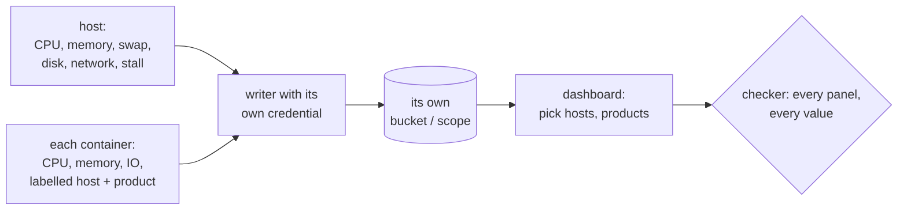

# Resource usage and capacity dashboards

**Every server reports its resource usage, per host and per container, including stall, and each writer pushes with its own credential that reaches only its own data. Dashboards let you pick hosts and products, never a storage target, have readable uids, and every panel is checked for data for each value it offers before a change is merged.** Decided 2026-11-04.

## Why

On 2026-10-26 a host ran out of memory and the page that arrived was a sidecar's health check; finding which guest was growing took an hour of ad-hoc queries, because no view ranked guests by growth. On 2026-11-04 the same monitoring showed three more faults: two hosts wrote into one bucket with one shared token, so either host could overwrite or delete the other's history; a dashboard's bucket dropdown offered targets it could not render, so picking one showed "No data" everywhere; and one server had never pushed metrics at all. In another setup the metrics stopped at the host, so no number said which product a server's load belonged to.

## How

- **Host metrics:** CPU, memory and available memory, swap, disk use and IO, network, load, and pressure stall (PSI: memory, IO, CPU; the node exporter's `pressure` collector). Stall separates "busy" from "short of memory", which percent-used cannot.
- **Container metrics:** CPU, memory working set and limit, disk IO and network per container (cAdvisor, or the platform's own per-guest series), labelled with `host` and `product`, the labels the logs carry.
- **Disk health on physical disks:** SMART per disk from `smartctl --json`, reading both the ATA attribute table and the NVMe health log; a disk that refuses SMART is skipped with a log line, never silently. Cloud volumes have none; say so.
- **One credential per writer.** Each server pushes with a token that can write only its own bucket or scope and cannot read. Where the store has no per-scope tokens, the receiving end enforces it (a reverse proxy credential per server, a tenant per product). Prove it: a write to another target must be refused.
- **Retention that answers "what was it like a month ago":** at least 90 days for metrics.
- **Dashboards pick what the reader thinks in:** hosts, products, guests. Never a bucket, a datasource or an index. A variable lists only values the dashboard can render.
- **Readable uids** (`pve`, `servers`, `pbs`), never the random one an import assigns. Changing a provisioned dashboard's uid is a move to a new file path as well: Grafana's provisioner ties a path to its dashboard and refuses a new uid at the same path.
- **A capacity view per host:** memory and swap per container (stacked) with the share now, memory and IO stall per container over time, and a ranking "grew most in the last 30 minutes". This is the view the first page of a squeeze links to.
- **Queries over several stores keep their filters inside each branch.** In Flux, `union(tables: [from(a) |> range() |> filter(), from(b) |> range() |> filter()])`: a filter after the union is not pushed down, and the panel scans the whole range of both stores.
- **Check every panel before merging a dashboard change.** A script runs each panel's query through Grafana's `/api/ds/query` once per value of each variable (`--var host=a`, `--var host=b`) and fails on an empty panel unless it is listed as empty by nature for that value, with the reason. A check on the saved default alone passes a panel that is empty for every other host.

## Rules out

- Two writers sharing one write credential, or a credential that can write another host's or product's data.
- Metrics that stop at the host when the host runs several products.
- A dropdown of buckets, datasources or indexes on a dashboard.
- A random import uid on a provisioned dashboard.
- Merging a dashboard change without running the checker for every variable value.

## Reference

The homelab's main repository and its monitoring repository (one bucket and one write-only token per box, the history of a shared bucket moved out by count, SMART for SATA and NVMe, dashboards that pick hosts, readable uids, `check-dashboards.py --var`; 2026-11-04). To be applied in the business's stacks repository. Both are private.
