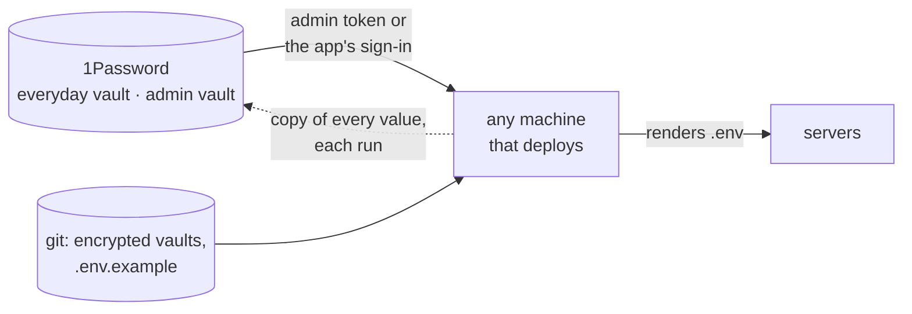

# Every secret in the password manager

**Every secret of every machine and every stack is in the password manager, 1Password, from the moment it exists: each `.env` value, password, API token, SSH key, encryption, backup and recovery key, and the password of every encrypted file. Losing any one machine, the one that deploys included, loses no secret and no access.** Decided 2026-11-02.

A machine that deploys needs a clone and access to 1Password, nothing else. Everything secret it uses comes from there, or from an encrypted file whose password does.

## Why

The servers of the business could only be maintained from one development machine: the Ansible vault's password and the deployment SSH key existed in a file there and nowhere else. Losing that machine would have locked every server out of its own configuration. The homelab had found the same in October 2026 and moved its secrets to 1Password first; the business followed on 2026-11-02.

## How

- **When a secret is made, it goes into 1Password before it is used:** a generated password, a provider's API token, a key a tool prints once (an unseal key, a recovery code, a service account's token). Never only in a file on one machine, a terminal's scrollback or a chat.
- **Two vaults per scope:** an everyday one (`<Scope>`) for app and provider secrets, and `<Scope> Admin` for what opens everything else: vault passwords, deployment SSH keys, root and recovery keys, service-account tokens. A different owner (another legal entity) gets vaults of its own.
- **Service accounts named by their access** (`<scope>-read-write`, `<scope>-admin-read-write`), because 1Password can't change a service account's permissions later. The admin token sits only on the machine that deploys; any other machine signs in through the 1Password app. A server gets a token only when it must read secrets itself, and never the admin one.
- **Encrypted files in git are allowed** (an Ansible vault): their password is in the admin vault and read through one wrapper script (`op.sh`), so `ansible.cfg` names the script, not a file. Each run copies every value of the encrypted file into 1Password, so it can be read without a clone; the file stays the source.
- **A server's `.env`** is rendered from those secrets, or stored whole in 1Password when the server writes it itself; either way, every value in it can be found there.
- **Reading and writing:** `op item get --format json` (never `op read` for a value that must stay byte-exact; it appends a newline), `--cache=false`, values through a 0600 file, never on a command line or in output.
- **The check:** from a machine with no local secrets, a clone plus 1Password can run the deployment's dry run.

## Rules out

- A secret, password file or key that exists only on one machine.
- A token, password or key pasted into a chat, an issue or a command line.
- Secrets committed unencrypted; an encrypted file whose password is not in 1Password.
- The admin vault's token on a server; one service account for everything.
- A copy in 1Password edited by hand when the encrypted file is the source.

## Reference

The business's deployment repository (ADR 0002: the vault password, the deployment key and a copy of every vault value in 1Password; `scripts/op.sh`, `scripts/vault-pass.sh`, `roles/vault_mirror`) and the homelab's (ADR-0104, ADR-0110, ADR-0112: whole `.env` files in 1Password, an admin vault, the laptop as a second control node). Both repositories are private.
