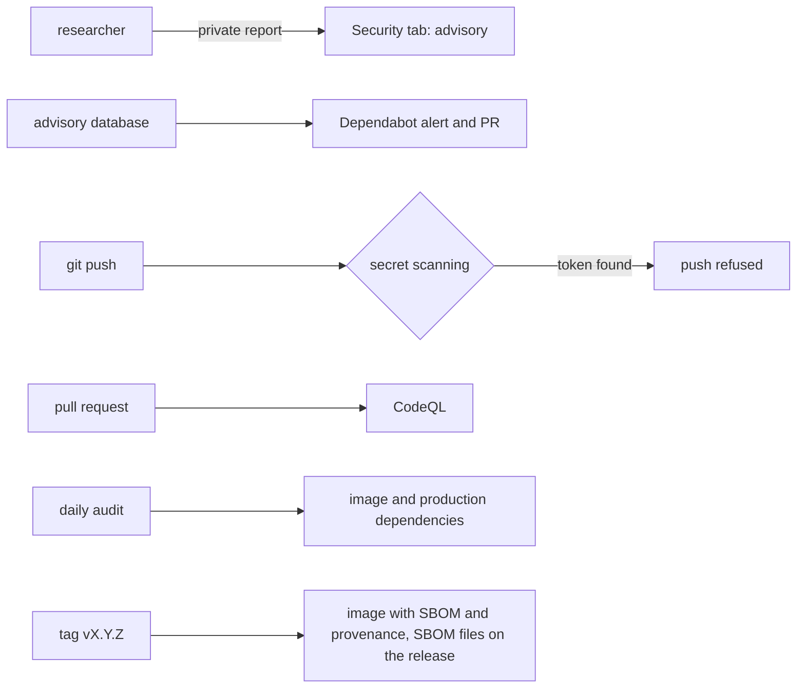

# Security setup

**Every public repository takes vulnerability reports privately, watches its dependencies, code and secrets with GitHub's own tools, audits what it ships every day, and puts an SBOM and a build provenance on every release. A `SECURITY.md` says all of it.** Decided 2026-11-04.



Each way a vulnerability can arrive has its own watch; the release then says exactly what it contains.

## Why

On 2026-11-04 Gamepanion's imprint pointed to its repository's Security tab, and nothing was switched on behind it: no private reporting, no `SECURITY.md`, no Dependabot alerts, no secret or code scanning. notefeed had the release side (SBOM, provenance, a daily audit) but neither secret scanning nor CodeQL. Every one of these is free for a public repository and takes minutes to switch on; missing one leaves a gap that only shows when someone needs it: a researcher with nowhere to report, a token pushed by accident, a vulnerable package nobody is told about, or a self-hoster who can't tell whether a CVE affects the image they run.

CodeQL runs from one shared workflow, not GitHub's default setup, since 2026-11-24. Default setup can't leave out paths, and tests that prove personal data never reaches a log hold invented personal data on purpose: in securo-ing-fints, CodeQL reported such a fixture as a clear-text leak, an annotation every contributor sees on their pull request. Somebody deciding whether to trust a tool with their bank data reads that as a security problem. The shared workflow leaves out test code only, with one list for every repository; the tests stay under secret scanning.

## How

1. **Repository settings** (or _Settings → Code security_), each one call:
    - private vulnerability reporting: `gh api -X PUT repos/<owner>/<repo>/private-vulnerability-reporting`;
    - Dependabot alerts and security updates: as [Dependabot with auto-merge](dependabot.md) says;
    - secret scanning with push protection: `gh api -X PATCH repos/<owner>/<repo> --input -` with `{"security_and_analysis": {"secret_scanning": {"status": "enabled"}, "secret_scanning_push_protection": {"status": "enabled"}}}`;
    - CodeQL default setup **off** (`gh api -X PATCH repos/<owner>/<repo>/code-scanning/default-setup -f state=not-configured`): GitHub refuses results from a workflow while it is on. CodeQL runs from the shared workflow instead, step 2.
    Check with `gh api repos/<owner>/<repo> --jq .security_and_analysis` and `gh api repos/<owner>/<repo>/private-vulnerability-reporting`.
2. **CodeQL from the shared workflow**: `.github/workflows/codeql.yml` in the repository calls [this repository's `codeql.yml`](https://github.com/Marceltov/engineering-conventions/blob/main/.github/workflows/codeql.yml) with the repository's languages. The shared one leaves out test code (`tests/`, `test/`, `__tests__/`, `test_*.py`, `*_test.py`, `conftest.py`, `*.test.*` and `*.spec.*` for TypeScript and JavaScript, `*_test.go`) and nothing else; `scripts/check_codeql_paths.py` here proves the list against sample paths in CI, so a change to it can't leave out code that ships. A language CodeQL compiles (Java, Kotlin, C#, Go) is analysed as built: its tests stay out of the build as well.

    ```yaml
    name: codeql
    on:
      push:
        branches: [main]
      pull_request:
      schedule:
        - cron: "41 4 * * 1"
    permissions:
      contents: read
    jobs:
      codeql:
        permissions:
          contents: read
          actions: read
          security-events: write
        uses: Marceltov/engineering-conventions/.github/workflows/codeql.yml@main
        with:
          languages: '["python", "actions"]'
    ```

    `@main`, not a pinned commit: a correction to the shared list then reaches every repository at once, and the workflow is ours. `actions` scans the repository's own workflows; add it for every repository.
3. **`SECURITY.md`** at the root, four sections: _Reporting a vulnerability_ (the **Report a vulnerability** link on the Security tab, never a public issue; what it covers: the server, the image, the hosted service; an answer within seven days; the advisory is published with the reporter named, unless they'd rather not be); _Supported versions_ (only the newest release gets fixes, no backports); _What each release carries_ (the SBOM files and how to read the image's SBOM and provenance); _How this repository watches_ (the list below; it names the shared CodeQL workflow and that it leaves out the tests). The product's imprint names the Security tab, or a `security@` address that reaches the same people.
4. **Dependabot**, with auto-merge for patch and minor bumps: [Dependabot with auto-merge](dependabot.md).
5. **A daily audit** (`.github/workflows/audit.yml`), on a schedule because an advisory arrives without a commit: `npm audit --omit=dev --audit-level=high` (`pip-audit` for Python) over the production dependencies, and `anchore/scan-action` over the published image with `only-fixed: true` and `severity-cutoff: high`. A red run means upgrading, or releasing again so the image is rebuilt on a fixed base.
6. **SBOM and provenance on every release** ([Releases](releases.md)):
    - the image is built with `sbom: true` and `provenance: mode=max` (`docker/build-push-action`), so both are attached to it in the registry (`docker buildx imagetools inspect <image>:X.Y.Z --format '{{ json .SBOM }}'`, `.Provenance` likewise);
    - the image job writes two CycloneDX files, `<name>-X.Y.Z-npm.cdx.json` (`npm sbom --package-lock-only --omit dev --sbom-format cyclonedx`, after setting the package's version to the tag's) and `<name>-X.Y.Z-image.cdx.json` (`anchore/sbom-action` on the pushed digest), and uploads them as an artifact; the release job attaches them to the GitHub release;
    - the steps run on every push to `main` too, so a broken one shows before a tag needs it.

## Rules out

- A public repository without private vulnerability reporting, a `SECURITY.md`, secret scanning with push protection or code scanning.
- An imprint or `SECURITY.md` pointing to a reporting channel that isn't switched on.
- Asking for vulnerability reports in public issues.
- A release without its SBOM files, or an image without SBOM and provenance.
- Relying on Dependabot alone, without the scheduled audit of the published image.
- CodeQL's default setup, or a repository's own CodeQL workflow or list of paths it leaves out: changes to the list go into the shared workflow, with its check.
- Leaving out of CodeQL anything but test code.

## Reference

notefeed (`SECURITY.md`, `.github/workflows/ci.yml` and `audit.yml`; secret scanning and CodeQL switched on 2026-11-04) and Gamepanion (gamepanion/gamepanion#117). The shared CodeQL workflow: Marceltov/securo-ing-fints and Marceltov/securo-trade-republic, where a deliberate leak in the package was reported and the test fixtures were not (securo-ing-fints pull request 7).
