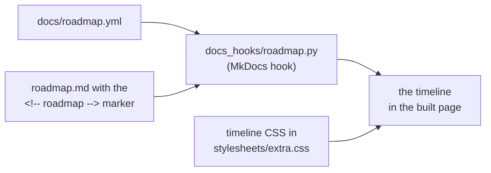

# Values and roadmap pages

**Every project has two pages in its docs: a values page, what it stands for, and a roadmap page, what is planned.** The values page is the yardstick every change is judged against; the roadmap says where the project is going, inside those values. Decided 2026-10-29.

## Why

Without written values, every review argues from taste, and a project drifts toward whatever was easiest to build. A values point that says what it rules out settles a review in one line ("this breaks V2"). The roadmap keeps plans next to the reasons for them, each one tied to the value it serves.

## The values page

Title "What \<project\> stands for", right after Home in the docs nav (`docs/values.md`).

- **Intro (two paragraphs):** what the project is and that this page says what it will stay, whoever runs it and whatever it grows into; then who it is for (someone deciding whether to trust it) and that it is the yardstick: a contribution, from a person or an AI, is judged against these points, and a review names the one it touches.
- **Three groups**, points numbered across them (V1, V2, …):
    - **Lines never crossed**: two or three points. "When a feature would be easier, or would sell better, by bending one of them, the feature changes or is not built."
    - **What you can rely on**: why someone can trust it (what is kept, how they leave, where it runs, how it is paid for).
    - **Principles that follow**: the design rules that come out of the above.
- **Each point:** a heading `Vn. Title`, prose (the statement, then what it means in practice), a bold **Rules out:** line listing concretely what it excludes, and an **ADRs:** line linking the decisions behind it. No examples sections, no "we will / we won't" lists.
- **Closing section "Changing this page":** points keep their numbers so reviews and issues citing them stay right; a change needs the maintainer's approval and says why in its pull request; weakening a line never crossed is a change to what the project is.
- **`CLAUDE.md`** gets one rule: changes are judged against `docs/values.md`, and a review names the point it touches.
- Write points so they leave room for what is planned.

## The roadmap page

Title "Where \<project\> is going" (or "Roadmap"), in the menu's _Contributing_ section or right after the values page (`docs/roadmap.md`). **It is a visual timeline rendered from a data file**, as passageway's ([passageway.marceltov.de/roadmap](https://passageway.marceltov.de/roadmap/)): what is planned on top, what has shipped below with the day it shipped. Decided 2026-10-30.

The hook reads the data file and puts the timeline where the marker is; the site's CSS draws it.

### How it is built

- **The data:** `docs/roadmap.yml`, a list of `items`. Each has an `id`, a `status` (`now`, `next`, `later` or `done`; passageway also has `decide`), a `when` label for open steps (Now / Next / Later) or a `date` for done ones, a Material Design `icon` name, a `title`, a one-sentence `summary`, `links` (label and URL: the issue, the value point, an ADR, the pull request) and optional `details` (a small Markdown subset).
- **The hook:** `docs_hooks/roadmap.py`, registered under `hooks:` in `mkdocs.yml`, replaces the `<!-- roadmap -->` marker in `roadmap.md` with the timeline. It escapes every text, inlines the icons from the installed mkdocs-material, and fails the build on an unknown icon or a missing marker, so `mkdocs build --strict` checks the data. Copy it from passageway and rename the CSS prefix (`pw-` → the project's own).
- **The look:** the timeline CSS in `docs/stylesheets/extra.css`, in the project's own palette, with no colour of its own: every marker is the site's accent. A label on the left (Now / Next / Later, or the date for what shipped), a line with a marker (hollow: planned; a thicker ring with a soft halo: being built now; filled with a check: shipped), and a card with icon, title, the links on the right and the summary. On a phone the label moves into the card. Check light, dark and phone width before merging.
- **Links in the timeline are raw HTML**, which MkDocs does not rewrite: give value points and ADRs as absolute site URLs (`https://…/values/#v4-…`), not `values.md#…`.

### What the page says

- **Front matter** `hide: [toc]`.
- **Intro:** where the project comes from and what it is becoming, in two or three sentences; then that the page says what is planned and why, inside the values, and what has shipped. Planned steps have **no dates**, only now, next or later; shipped steps carry the day they shipped; a dropped step leaves the timeline, with the reason in its issue.
- **The idea behind all of it:** one paragraph, the thread every step follows.
- **The timeline** (the marker): open steps first, in file order (now, next, later); shipped steps below, newest first. Start the shipped part with the project's first release and the larger features since, not every fix.
- **Parked** (considered and wanted, but not needed yet) and **Decided against** (with the reason, often a value it would break): text under the timeline.
- **Keep it true:** the timeline is rendered from `docs/roadmap.yml` (on GitHub, read that file); the pull request that finishes a step sets `status: done`, replaces `when` with a `date`, adds its link and moves it to the top of the shipped entries; the pull request that changes the plan changes the file.
- **Every step has an issue** (create one when it doesn't) **and names the value point it serves.** Check that every value link matches the anchor MkDocs generates for that heading.
- **`CLAUDE.md`** gets one rule: the roadmap is `docs/roadmap.yml`, and the pull request that finishes or changes a step updates it.

## Rules out

- A project without a values page, or a values point without a **Rules out:** line.
- Renumbering values points.
- Roadmap steps without an issue or a value point, or planned steps with dates.
- A roadmap as plain text, or one that drops what shipped.
- Relative links (`values.md#…`) inside the timeline.
- Timeline colours from another project's palette (passageway's warm `now` ring copied into a blue or green site).

## Reference

notefeed's values page ([docs.notefeed.me/values](https://docs.notefeed.me/values/)); passageway's roadmap (the reference for the timeline); freundebuch's values page and timeline (Marceltov/freundebuch#94); mcp-login-oauth's values and timeline.
