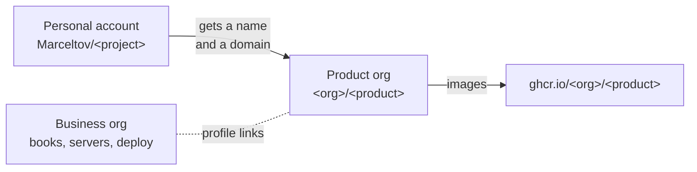

# Where a repository lives

**A product with its own name has its own GitHub org, and its images are published as `ghcr.io/<org>/<product>`. Running the business lives in the business org. Something new starts under the personal account `Marceltov` and moves to its own org once it has a name and a domain.** Decided 2026-11-01.

## Why

Thirteen orgs had grown without a rule. Some products had an org, others lived under the personal account, and some orgs only grouped personal work. Two simpler setups were considered on 2026-11-01: everything under the personal account, or everything in one business org with the product as a prefix (`notefeed-stacks`). Both would have moved every product image. A repository that moves gets a redirect; an image does not. Anyone who self-hosts a product pulls its image by name, so every existing `compose.yaml` would break. Some products are many repositories, too: one has 19, another 6.

So a product's name becomes fixed once someone runs it, and that is the moment it gets an org. Before that, a move costs nothing.

## How

A project moves to its own org once it has a name; from then on the org and the image name stay.

| What | Where |
|---|---|
| A product with its own name | Its own org, named as the brand is written: the app (`<product>`), `stacks`, `legal`, `docs`, `landing`, `.github` |
| Running the business: books, contracts, servers, the deploy repo | The business org |
| A new project, a library, a tool without its own brand | The personal account `Marceltov` |
| Work shared with other people, personal archives | Their own orgs, outside the business |

- **Moving a project to its org:** create the org, allow deploy keys in its settings (new orgs forbid them), transfer the repository, and publish images under the org from the next release. Move before anyone self-hosts it.
- **Same role, same name.** Inside a product org, repos are named by role, so `stacks` or `legal` means the same thing in every org.
- **The orgs link up by hand.** GitHub can't nest orgs: the business org's profile lists every product, and each product's profile links back to the business.
- **No empty-looking orgs.** A product org has a profile README (`.github/profile/README.md`, in the product's language) and pins its main repos.

## Rules out

- An image name that changes after the product's first release under its org.
- A product org for a project without a name and a domain.
- Repos that run the business (books, contracts, servers, deploy) in the personal account or in a product org.
- A product's repos spread across several orgs, or prefixed with the product name inside a shared org.
- Deleting an org that repos were moved out of: the redirects end and the name is free for anyone.

## Reference

[notefeed](https://github.com/notefeed), [noticebox](https://github.com/noticebox) and [Gesetze-fuer-KI](https://github.com/Gesetze-fuer-KI) (product orgs with their images); gamepanion (moved from the personal account once it had its name).
